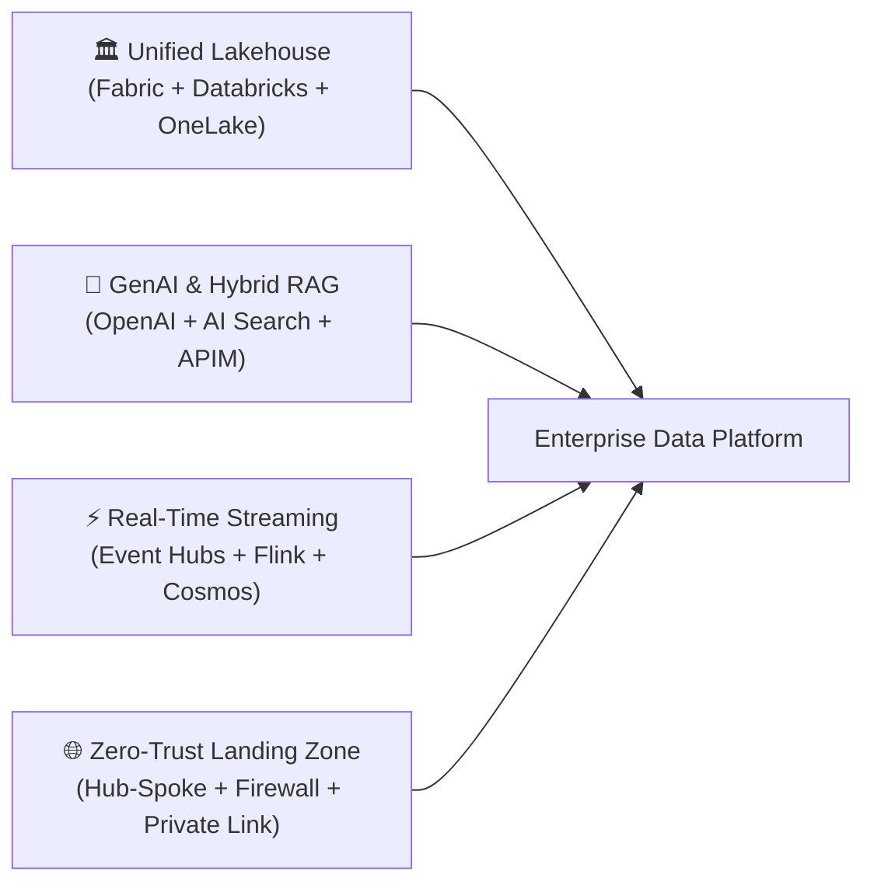
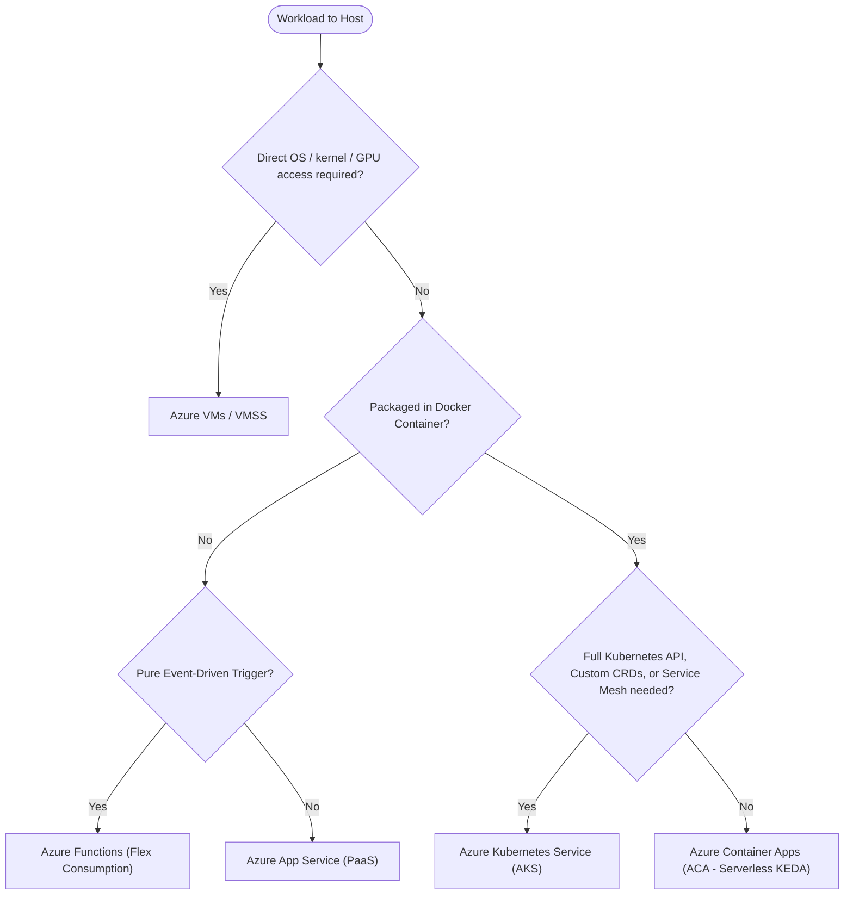
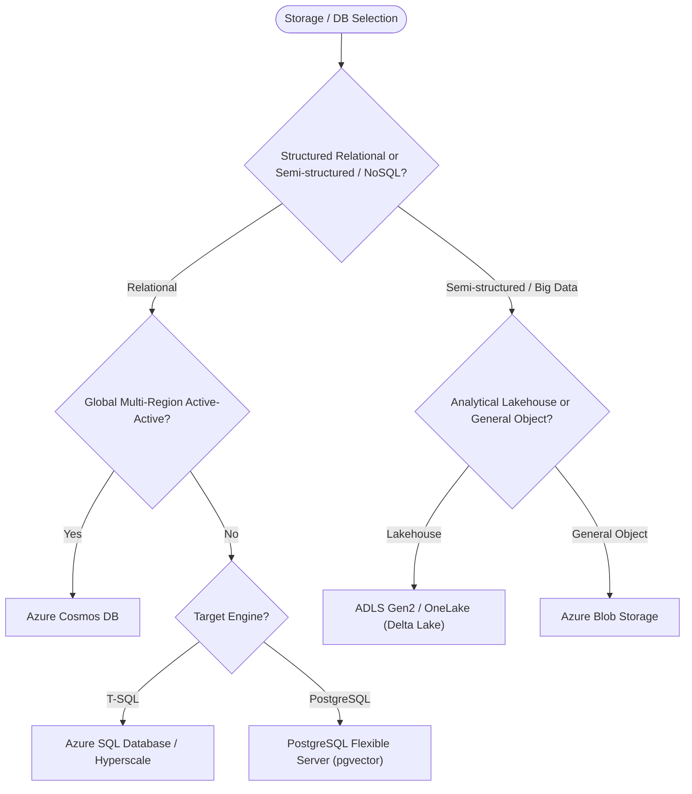

# ⚡ The Modern Microsoft Azure Developer & Architect Cheat Sheet

[](https://github.com/santoshjammi29/azure-cheat-sheet/actions)
[](https://azure.microsoft.com/)
[](https://learn.microsoft.com/fabric/)
[](https://learn.microsoft.com/azure/ai-services/openai/)
[](https://learn.microsoft.com/entra/)
[](cheatsheets/bicep-iac-cheat-sheet.md)
[](https://creativecommons.org/licenses/by/4.0/)

> The definitive, production-tested reference guide to **300+ Microsoft Azure services**, modern architectures (**Microsoft Fabric**, **Azure Databricks**, **GenAI / RAG**, **Entra ID**), CLI commands, Bicep IaC, decision trees, and FinOps runbooks.  
> Grounded in real-world enterprise architectures from [**Lakehouse Architect**](https://santoshjammi.in) and the interactive [**azurecheatsheet.com**](https://azurecheatsheet.com).

---

## 🌐 Interactive Version

Check out the interactive version of the cheat sheet:

👉 **[azurecheatsheet.com](https://azurecheatsheet.com)**


---

## 📑 Table of Contents

- [🚀 Modern Reference Guides & Cheatsheets](#-modern-reference-guides--cheatsheets)
- [🏛️ Enterprise Production Blueprints](#️-enterprise-production-blueprints)
- [🔄 Key Service Evolutions & Renaming Index](#-key-service-evolutions--renaming-index)
- [🧭 Master Architectural Decision Trees](#-master-architectural-decision-trees)
- [💻 Azure CLI (`az`) Fast Reference](#-azure-cli-az-fast-reference)
- [💰 The 5 Golden Rules of Azure FinOps](#-the-5-golden-rules-of-azure-finops)
- [🎓 Azure Certification Roadmap](#-azure-certification-roadmap)
- [🖼️ Downloadable Visual Posters & Cheat Sheets](#️-downloadable-visual-posters--cheat-sheets)
- [📦 Complete Azure Services & Products Catalog](#-complete-azure-services--products-catalog)
  - [1. Compute](#1-compute)
  - [2. Artificial Intelligence & Machine Learning](#2-artificial-intelligence--machine-learning)
  - [3. Analytics & Big Data](#3-analytics--big-data)
  - [4. Databases](#4-databases)
  - [5. Storage](#5-storage)
  - [6. Networking](#6-networking)
  - [7. Security & Identity](#7-security--identity)
  - [8. DevOps & Developer Tooling](#8-devops--developer-tooling)
  - [9. Integration & Messaging](#9-integration--messaging)
  - [10. Web & Mobile](#10-web--mobile)
  - [11. Hybrid & Multicloud](#11-hybrid--multicloud)
  - [12. Management & Governance](#12-management--governance)
  - [13. Internet of Things (IoT)](#13-internet-of-things-iot)
- [☕ Support the Project](#-support-the-project)
- [🤝 Authors & Acknowledgments](#-authors--acknowledgments)

---

## 🚀 Modern Reference Guides & Cheatsheets

Dedicated modular cheat sheets with ready-to-run scripts, configuration syntax, and real-world tips:

| Guide | Description | Key Highlights |
| :--- | :--- | :--- |
| [**💻 Azure CLI Production Cheat Sheet**](cheatsheets/azure-cli-cheat-sheet.md) | 150+ battle-tested `az` commands across core services. | JMESPath `--query` recipes, AKS, ACA, Fabric F-SKU pause/resume, Key Vault, and orphan cleanup. |
| [**🏗️ Azure Bicep & IaC Developer Guide**](cheatsheets/bicep-iac-cheat-sheet.md) | Modern declarative infrastructure as code with Bicep & `azd`. | Decorators, modules, loops, conditionals, `@secure` secrets, and complete production Landing Zone template. |
| [**🔄 Service Evolution & Renaming Map**](cheatsheets/azure-service-map-and-renames.md) | Definitive tracker for service rebrands and retirements. | Azure AD ➔ Entra ID, Cognitive Search ➔ Azure AI Search, Synapse ➔ Fabric, and retirement runbooks. |
| [**🧭 Architecture Decision Trees**](cheatsheets/decision-matrices.md) | Flowcharts and trade-off comparison matrices. | Compute (AKS vs ACA vs Functions), DBs (Cosmos vs SQL vs Postgres), Messaging (Event Hubs vs Service Bus). |
| [**💰 FinOps & Cost Optimization Runbook**](cheatsheets/finops-and-cost-optimization.md) | Enterprise guide to slashing cloud waste by 40-70%. | Savings Plans, Spot VMs with eviction handling, Storage Tiering economics, and non-prod schedule automation. |
| [**🛡️ Zero Trust Security & Identity Guide**](cheatsheets/security-zero-trust.md) | Hardening Azure perimeter, identity, and data. | Managed Identities, GitHub Actions OIDC (`azure/login@v2`), Private Link topology, and Key Vault RBAC. |

---

## 🏛️ Enterprise Production Blueprints

Production-grade blueprints featuring architecture diagrams, sequence flows, persona models, and triage runbooks:



1. [**🏛️ Unified Lakehouse with Microsoft Fabric & Azure Databricks**](architectures/enterprise-lakehouse-fabric.md): Multi-engine Medallion architecture (Bronze ➔ Silver ➔ Gold) unifying OneLake, Delta Lake 3.x, Unity Catalog, and Power BI Direct Lake mode.
2. [**🤖 Enterprise GenAI & Hybrid RAG Platform**](architectures/genai-rag-openai-search.md): Sub-second enterprise RAG leveraging Azure OpenAI (GPT-4o), Azure AI Search (Hybrid BM25 + Vector + Semantic Ranker), Document Intelligence, and API Management rate limiting.
3. [**⚡ High-Throughput Real-Time Streaming & IoT Platform**](architectures/real-time-streaming-iot.md): Ingesting and serving 2,000,000 events/sec via Azure Event Hubs, Apache Flink / Structured Streaming, Azure Cosmos DB, and Fabric Eventhouse.
4. [**🌐 Enterprise Landing Zone & Zero-Trust Hub-Spoke Network**](architectures/enterprise-landing-zone-hub-spoke.md): Microsoft Cloud Adoption Framework (CAF) topology with Azure Firewall Premium (TLS inspection & IDPS), Private DNS Resolvers, and forced tunneling.

---

## 🔄 Key Service Evolutions & Renaming Index

Azure services continuously evolve. Here is the quick-reference cheat sheet for the most critical recent renames and transitions:

| Former Name | Current / Modern Name | Impact & Technical Upgrades |
| :--- | :--- | :--- |
| **Azure Active Directory (Azure AD)** | [**Microsoft Entra ID**](https://learn.microsoft.com/entra/) | Renamed under Entra portfolio. Unifies Workload Identities, Entra PIM, and Zero Trust access. |
| **Azure Cognitive Search** | [**Azure AI Search**](https://learn.microsoft.com/azure/search/) | Added native Vector Search (HNSW / DiskANN), Hybrid Retrieval, and Semantic Ranker cross-encoder. |
| **Azure Cognitive Services** | [**Azure AI Services / Azure AI Foundry**](https://learn.microsoft.com/azure/ai-studio/) | Unified multi-service APIs, Azure OpenAI integration, and unified AI Studio / Foundry portal. |
| **Azure Synapse Analytics** | [**Microsoft Fabric**](https://learn.microsoft.com/fabric/) | Next-generation unified SaaS platform centered on OneLake and open Delta Parquet format. |
| **Azure Security Center + Defender** | [**Microsoft Defender for Cloud**](https://learn.microsoft.com/azure/defender-for-cloud/) | Unified CSPM and CWPP multi-cloud defense across Azure, AWS, and GCP. |
| **Time Series Insights (TSI)** | [**Azure Data Explorer / Fabric Eventhouse**](https://learn.microsoft.com/azure/data-explorer/) | TSI retired. Real-time time-series telemetry workloads now use KQL-based Eventhouse / ADX. |
| **ADLS Gen1** | [**ADLS Gen2**](https://learn.microsoft.com/azure/storage/blobs/data-lake-storage-introduction) | ADLS Gen1 retired Feb 2024. Gen2 integrates POSIX Hierarchical Namespace directly onto Blob Storage. |
| **PostgreSQL / MySQL Single Server** | [**Azure Database for PostgreSQL / MySQL Flexible**](https://learn.microsoft.com/azure/postgresql/flexible-server/) | Single Server retired. Flexible Server provides zone-redundant HA and `pgvector` AI support. |

*See full details, migration runbooks, and deprecations in the [Service Evolution Guide](cheatsheets/azure-service-map-and-renames.md).*

---

## 🧭 Master Architectural Decision Trees

### 1. Compute Selection Tree



### 2. Database & Storage Selection Tree



*See full decision matrices in [Architecture Decision Trees & Matrices](cheatsheets/decision-matrices.md).*

---

## 💻 Azure CLI (`az`) Fast Reference

```bash
# 1. Login & Subscription Selection
az login --use-device-code
az account set --subscription "Production-Subscription"

# 2. Deploy Azure Bicep Infrastructure with Preflight Diff
az deployment group what-if -g rg-lakehouse-prod -f main.bicep
az deployment group create -g rg-lakehouse-prod -f main.bicep --parameters @main.bicepparam

# 3. Create ADLS Gen2 Storage (Hierarchical Namespace)
az storage account create -g rg-data -n stlakehouse01 -l eastus \
  --sku Standard_ZRS --kind StorageV2 --enable-hierarchical-namespace true \
  --allow-blob-public-access false

# 4. FinOps: Suspend / Resume Microsoft Fabric Capacity
az fabric capacity suspend -g rg-fabric -n capfabricdev01
az fabric capacity resume  -g rg-fabric -n capfabricdev01

# 5. Tail Live Web App Logs
az webapp log tail -g rg-apps -n app-customer-portal

# 6. Find Unattached Idle Disks (FinOps Triage)
az disk list --query "[?managedBy==null].{Name:name, RG:resourceGroup, GB:diskSizeGb}" -o table
```

*For 150+ comprehensive CLI recipes, visit the [Azure CLI Cheat Sheet](cheatsheets/azure-cli-cheat-sheet.md).*

---

## 💰 The 5 Golden Rules of Azure FinOps

1. **Cover 70% of Baseline Compute with Reservations & Savings Plans**: Combine 3-Year Reserved Instances for fixed stateful databases and Azure Savings Plans for dynamic compute (up to 72% discount).
2. **Auto-Suspend Non-Production Environments**: Schedule Fabric capacities (`az fabric capacity suspend`), Synapse SQL pools, and dev VMs to shut down outside business hours—saving **70% of non-prod compute spend**.
3. **Automate Storage Lifecycle Policies**: Push raw landing data from Hot ➔ Cool after 30 days, Cold after 90 days, and Archive after 365 days (saving up to 95% on historical storage).
4. **Purge Orphaned Cloud Assets Monthly**: Continuously run scripts to delete unattached Managed Disks, idle Public IPs, and orphaned snapshots.
5. **Utilize Spot Instances for Batch & Fault-Tolerant Streaming**: Run ephemeral Spark worker pools on Spot VMs (up to 90% discount) with Azure Scheduled Events API eviction handlers.

*Read the full guide in the [FinOps & Cost Optimization Runbook](cheatsheets/finops-and-cost-optimization.md).*

---

## 🎓 Azure Certification Roadmap

| Certification | Code | Target Role | Key Knowledge Domains |
| :--- | :--- | :--- | :--- |
| **Azure Fundamentals** | `AZ-900` | Beginners, Sales, Managers | Cloud concepts, core Azure services, security, pricing, SLA. |
| **Azure Administrator Associate** | `AZ-104` | SysAdmins, Cloud Engineers | Virtual networking, compute, storage, Entra ID, governance, monitoring. |
| **Azure Developer Associate** | `AZ-204` | Software Engineers | Azure Functions, Container Apps, Cosmos DB, Blob, Key Vault, APIM, Event Grid. |
| **Azure Solutions Architect Expert** | `AZ-305` | Enterprise Architects | Design identity, governance, monitoring, data storage, business continuity, infra. |
| **Azure DevOps Engineer Expert** | `AZ-400` | DevOps / SRE Engineers | CI/CD pipelines, Bicep/Terraform, dependency management, security compliance. |
| **Azure Data Engineer Associate** | `DP-203` | Data Engineers | Data Factory, Synapse, Databricks, ADLS Gen2, stream processing, security. |
| **Fabric Analytics Engineer Associate** | `DP-600` | Analytics Engineers | Microsoft Fabric OneLake, Lakehouse, Warehouse, Direct Lake, DAX, PySpark. |
| **Azure AI Engineer Associate** | `AI-102` | AI Engineers | Azure OpenAI, Azure AI Search, Document Intelligence, Computer Vision, Speech. |
| **Cybersecurity Architect Expert** | `SC-100` | Security Architects | Zero Trust strategy, Microsoft Defender for Cloud, Microsoft Sentinel, Purview. |

---

## 🖼️ Downloadable Visual Posters & Cheat Sheets

> [!NOTE]
> **The original downloadable posters below were produced in August 2022 and have not been regenerated since.**
> They predate several major renames — Azure Active Directory is now Microsoft Entra ID, Cognitive Services is now Azure AI Services, Windows Virtual Desktop is now Azure Virtual Desktop — and they show some services that have since retired. For current information, use the [interactive version](https://azurecheatsheet.com) and the updated [text listings below](#-complete-azure-services--products-catalog).

### One-Page Visual Sheet (August 2022)
- **White background**: [High-Res PNG](1_page_version/LightSheet/Azure_developers_sheet_light-high_rez.png) | [Medium-Res PNG](1_page_version/LightSheet/Azure_developers_sheet_light-mid_rez.png) | [PDF](1_page_version/LightSheet/Azure_Developers_sheet-light.pdf) | [SVG](1_page_version/LightSheet/Azure_Developers_sheet-light.svg)
- **Dark background**: [High-Res PNG](1_page_version/DarkSheet/Azure_developers_sheet_dark-high_rez.png) | [Medium-Res PNG](1_page_version/DarkSheet/Azure_developers_sheet_dark-mid_rez.png) | [PDF](1_page_version/DarkSheet/Azure_Developers_sheet-dark.pdf) | [SVG](1_page_version/DarkSheet/Azure_Developers_sheet-dark.svg)

<p align="center">
  <a target="_blank" href="1_page_version/DarkSheet/Azure_developers_sheet_dark-mid_rez.png">
    
  </a>
</p>

### Two-Page Visual Sheet (August 2022)
- **White background**: [Page 1 High-Res](2_page_version/LightSheet/High/Azure-document-light-1st-page-highrez.png) | [Page 2 High-Res](2_page_version/LightSheet/High/Azure-document-light-2nd-page-highrez.png) | [PDF](2_page_version/LightSheet/Azure_Developers_2_page_sheet_light.pdf)
- **Dark background**: [Page 1 High-Res](2_page_version/DarkSheet/High/Azure-document-dark-1st-page-highrez.png) | [Page 2 High-Res](2_page_version/DarkSheet/High/Azure-document-dark-2nd-page-highrez.png) | [PDF](2_page_version/DarkSheet/Azure_Developers_2_page_sheet_dark.pdf)

### Bonus Cheat Sheets
- **Azure Cloud Services Cheat Sheet (May 2024)**: [View Image](Azure-Cloud-services-cheat-sheet.png) • [Download PDF](Azure-Cloud-Services-cheat-sheet.pdf)
- **Azure Load Balancers Cheat Sheet (June 2024)**: [View Image](Azure-load-balancer---cheat-sheet.png) • [Download PDF](Azure-load-balancer-cheat-sheet.pdf)

---

## 📦 Complete Azure Services & Products Catalog

*Directly verified against Microsoft Learn and Azure Product Catalog.*

### 1. Compute

* [**Azure App Service**](https://azure.microsoft.com/en-gb/products/app-service/): Quickly create and host powerful cloud apps and REST APIs for web and mobile.
* [**Azure Container Apps (ACA)**](https://azure.microsoft.com/en-gb/products/container-apps/): Fully managed serverless container runtime powered by Kubernetes, KEDA, Envoy, and Dapr.
* [**Azure Kubernetes Service (AKS)**](https://azure.microsoft.com/en-gb/products/kubernetes-service/): Production-grade managed Kubernetes with Azure CNI Overlay, Cilium network policies, and Karpenter autoscaling.
* [**Azure Functions**](https://azure.microsoft.com/en-gb/products/functions/): Execute event-driven serverless code with the high-performance Flex Consumption tier.
* [**Virtual Machines**](https://azure.microsoft.com/en-gb/products/virtual-machines/): Provision Windows and Linux virtual machines in seconds with Intel, AMD, and ARM processors.
* [**Virtual Machine Scale Sets (VMSS)**](https://azure.microsoft.com/en-gb/products/virtual-machine-scale-sets/): Manage and scale up to thousands of Linux and Windows VMs with Flexible orchestration.
* [**Azure Spot Virtual Machines**](https://azure.microsoft.com/en-gb/products/virtual-machines/spot/): Provision unused compute capacity at up to 90% discount for interruptible workloads.
* [**Azure Dedicated Host**](https://azure.microsoft.com/en-gb/products/virtual-machines/dedicated-host/): Physical servers dedicated to your organization's Azure VMs for compliance and hardware isolation.
* [**Azure Confidential VMs**](https://azure.microsoft.com/en-gb/solutions/confidential-compute/): Hardware-based isolation with confidential computing (AMD SEV-SNP / Intel TDX) for sensitive data.
* [**Batch**](https://azure.microsoft.com/en-gb/products/batch/): Cloud-scale parallel job scheduling and compute management.
* [**Static Web Apps**](https://azure.microsoft.com/en-gb/products/app-service/static/): Streamlined full-stack web hosting from Git repositories to global high availability.
* [**Azure Virtual Desktop**](https://azure.microsoft.com/en-gb/products/virtual-desktop/): Deliver secure, remote Windows 10/11 desktops and virtual apps to any device.
* [**Microsoft Dev Box**](https://azure.microsoft.com/en-gb/products/dev-box/): High-performance, self-service cloud workstations preconfigured and ready to code.
* [**Azure Deployment Environments**](https://azure.microsoft.com/en-gb/products/deployment-environments/): Enable developers to spin up secure app infrastructure environments using project-based templates.
* [**Azure Compute Fleet**](https://azure.microsoft.com/en-gb/products/compute-fleet/): Centrally manage and deploy mixed VM types, Spot instances, and zones for high availability at scale.
* [**Azure Spring Apps**](https://azure.microsoft.com/en-gb/products/spring-apps): Fully managed Spring Boot app hosting from Microsoft and VMware (retires 31 March 2028; migrate to ACA or AKS).

---

### 2. Artificial Intelligence & Machine Learning

* [**Azure AI Foundry**](https://learn.microsoft.com/azure/ai-studio/): Enterprise platform for discovering, customizing, evaluating, and deploying generative AI and agents at scale.
* [**Azure OpenAI Service**](https://learn.microsoft.com/azure/ai-services/openai/): Enterprise-grade access to cutting-edge models (GPT-4o, GPT-4o mini, o1, o3-mini, DALL-E 3, Whisper) with VNet security.
* [**Azure AI Search**](https://azure.microsoft.com/en-gb/products/ai-services/ai-search/): Enterprise retrieval engine powering RAG with Hybrid Search (dense vector + BM25 keyword) and Semantic Ranker.
* [**Azure AI Document Intelligence**](https://azure.microsoft.com/en-gb/products/ai-services/ai-document-intelligence/): Advanced OCR extracting layout, tables, key-value pairs, and Markdown from documents and PDFs.
* [**Azure AI Content Safety**](https://azure.microsoft.com/en-gb/products/ai-services/ai-content-safety/): AI moderation detecting prompt injection attacks, jailbreaks, toxicity, and sensitive data leaks.
* [**Azure Machine Learning**](https://azure.microsoft.com/en-gb/products/machine-learning/): Comprehensive MLOps platform for training, fine-tuning, MLflow registry tracking, and deploying custom models.
* [**Azure AI Speech**](https://azure.microsoft.com/en-gb/products/ai-services/ai-speech/): Highly accurate speech-to-text, natural text-to-speech, translation, and speaker identification.
* [**Azure AI Vision**](https://azure.microsoft.com/en-gb/products/ai-services/ai-vision/): Computer vision for image analysis, spatial analysis, face verification, and multi-modal vector embeddings.
* [**Azure AI Language**](https://azure.microsoft.com/en-gb/products/ai-services/ai-language/): Natural language processing for sentiment analysis, entity extraction, PII redaction, and summarization.
* [**Azure AI Video Indexer**](https://azure.microsoft.com/en-gb/products/ai-video-indexer/): Extract actionable visual and audio insights from video files.

---

### 3. Analytics & Big Data

* [**Microsoft Fabric**](https://learn.microsoft.com/fabric/): End-to-end SaaS analytics platform unifying OneLake, Lakehouse, Data Warehouse, Real-Time Intelligence, and Data Factory.
* [**Azure Databricks**](https://azure.microsoft.com/en-gb/products/databricks/): Collaborative data and AI platform powered by Apache Spark, Photon, Delta Lake 3.x, and Unity Catalog.
* [**Azure Synapse Analytics**](https://azure.microsoft.com/en-gb/products/synapse-analytics/): Enterprise data platform integrating Massively Parallel Processing (MPP) Dedicated SQL Pools, Serverless SQL, and Spark.
* [**Azure Data Factory (ADF)**](https://azure.microsoft.com/en-gb/products/data-factory/): Cloud-scale hybrid ETL/ELT service with 100+ native connectors and Self-Hosted Integration Runtimes.
* [**Azure Data Explorer (ADX / Kusto)**](https://azure.microsoft.com/en-gb/products/data-explorer/): Ultra-fast time-series and log analytics query engine powered by Kusto Query Language (KQL).
* [**Azure Event Hubs**](https://azure.microsoft.com/en-gb/products/event-hubs/): Fully managed big data streaming platform supporting native Kafka protocols and Schema Registry.
* [**Azure Stream Analytics**](https://azure.microsoft.com/en-gb/products/stream-analytics/): Real-time complex event processing engine executing declarative SQL queries over streaming telemetry.
* [**Microsoft Purview**](https://www.microsoft.com/security/business/compliance/microsoft-purview): Unified data governance platform offering automated cataloging, sensitive data discovery, and lineage mapping.

---

### 4. Databases

* [**Azure Cosmos DB**](https://azure.microsoft.com/en-gb/products/cosmos-db/): Globally distributed, multi-model NoSQL and relational database with guaranteed single-digit millisecond latency and vector indexing.
* [**Azure SQL Database**](https://azure.microsoft.com/en-gb/products/azure-sql/database/): Fully managed relational database built on SQL Server with Serverless auto-pause and Hyperscale scaling up to 100TB.
* [**Azure SQL Managed Instance**](https://azure.microsoft.com/en-gb/products/azure-sql/managed-instance/): Cloud SQL Server with near 100% compatibility with on-premises instances and native VNet integration.
* [**Azure Database for PostgreSQL - Flexible Server**](https://azure.microsoft.com/en-gb/products/postgresql/): Managed PostgreSQL with zone-redundant HA, connection pooling (PgBouncer), and native `pgvector` support.
* [**Azure Database for MySQL - Flexible Server**](https://azure.microsoft.com/en-gb/products/mysql/): High-performance managed MySQL offering custom maintenance windows and IOPS autoscaling.
* [**Azure Managed Redis & Azure Cache for Redis**](https://azure.microsoft.com/en-gb/products/azure-cache-for-redis/): Ultra-fast in-memory data store for caching, session management, vector search, and pub/sub.

---

### 5. Storage

* [**Azure Data Lake Storage Gen2 (ADLS Gen2)**](https://learn.microsoft.com/azure/storage/blobs/data-lake-storage-introduction): Massively scalable object lakehouse storage featuring a true POSIX-compliant Hierarchical Namespace (HNS).
* [**Azure Blob Storage**](https://azure.microsoft.com/en-gb/products/storage/blobs/): Highly durable object storage with automated lifecycle management across Hot, Cool, Cold, and Archive tiers.
* [**Azure Files**](https://azure.microsoft.com/en-gb/products/storage/files/): Enterprise cloud file shares accessible via standard Server Message Block (SMB) and Network File System (NFS).
* [**Azure NetApp Files (ANF)**](https://azure.microsoft.com/en-gb/products/netapp/): Ultra-high performance, sub-millisecond latency enterprise file storage powered by NetApp ONTAP.
* [**Azure Managed Disks**](https://azure.microsoft.com/en-gb/products/storage/disks/): High-performance block storage volumes attached to Azure VMs (Ultra Disk, Premium SSD v2, Standard SSD).

---

### 6. Networking

* [**Azure Virtual Network (VNet)**](https://azure.microsoft.com/en-gb/products/virtual-network/): Fundamental building block for private networking, subnets, peering, and micro-segmentation.
* [**Azure Private Link & Private Endpoints**](https://azure.microsoft.com/en-gb/products/private-link/): Secure private connectivity from your VNet directly to Azure PaaS services, eliminating public internet exposure.
* [**Azure Front Door**](https://azure.microsoft.com/en-gb/products/frontdoor/): Global Layer 7 entry-point delivering unified CDN caching, edge Web Application Firewall (WAF), and anycast acceleration.
* [**Azure Application Gateway**](https://azure.microsoft.com/en-gb/products/application-gateway/): Regional Layer 7 web traffic load balancer and reverse proxy equipped with integrated OWASP WAF.
* [**Azure Load Balancer**](https://azure.microsoft.com/en-gb/products/load-balancer/): Ultra-low latency Layer 4 (TCP/UDP) inbound and outbound load balancing for VMs and container clusters.
* [**Azure Firewall Premium**](https://azure.microsoft.com/en-gb/products/azure-firewall/): Cloud-native stateful network firewall with TLS inspection, Intrusion Detection and Prevention (IDPS), and URL filtering.
* [**Azure Bastion**](https://azure.microsoft.com/en-gb/products/azure-bastion/): Secure, agentless browser-based RDP and SSH access to VMs without exposing public IP addresses.
* [**Azure ExpressRoute**](https://azure.microsoft.com/en-gb/products/expressroute/): Dedicated private high-bandwidth connection between on-premises datacenters and Azure cloud.
* [**Azure Virtual WAN (vWAN)**](https://azure.microsoft.com/en-gb/products/virtual-wan/): Unified global networking hub aggregating site-to-site VPN, point-to-site VPN, and ExpressRoute.
* [**Azure DNS Private Resolver**](https://learn.microsoft.com/azure/dns/dns-private-resolver-overview): Fully managed DNS forwarding service bridging on-premises DNS servers with Azure Private DNS zones.

---

### 7. Security & Identity

* [**Microsoft Entra ID**](https://learn.microsoft.com/entra/): Enterprise identity and access management delivering Conditional Access, passwordless sign-in, MFA, and Workload Identity Federation.
* [**Microsoft Entra PIM**](https://learn.microsoft.com/entra/id-governance/privileged-identity-management/pim-configure): Just-in-time, approval-based role activation for administrative privileges to eliminate persistent standing access.
* [**Azure Key Vault**](https://azure.microsoft.com/en-gb/products/key-vault/): Centralized store for safeguarding cryptographic keys, secrets, and TLS certificates with RBAC enforcement and purge protection.
* [**Microsoft Defender for Cloud**](https://www.microsoft.com/security/business/cloud-security/microsoft-defender-for-cloud): Cloud Security Posture Management (CSPM) and Workload Protection auditing against CIS, NIST, and ISO standards.
* [**Microsoft Sentinel**](https://www.microsoft.com/security/business/siem-and-xdr/microsoft-sentinel): Cloud-native Security Information and Event Management (SIEM) and Security Orchestration, Automation, and Response (SOAR).
* [**Azure Policy**](https://azure.microsoft.com/en-gb/products/azure-policy/): Enforce organizational standards, guardrails, and compliance across subscriptions at scale with automated remediation.

---

### 8. DevOps & Developer Tooling

* [**Azure Bicep**](https://learn.microsoft.com/azure/azure-resource-manager/bicep/): Modern, domain-specific language (DSL) for deploying declarative Azure infrastructure without raw ARM JSON boilerplate.
* [**Azure Developer CLI (`azd`)**](https://learn.microsoft.com/azure/developer/azure-developer-cli/): Open-source CLI accelerating developer inner-loop workflows from local code to cloud deployment in a single command (`azd up`).
* [**Azure DevOps Services**](https://azure.microsoft.com/en-gb/products/devops/): Enterprise collaboration tools including Azure Repos, Pipelines, Boards, Artifacts, and Test Plans.
* [**Azure Monitor & Log Analytics**](https://azure.microsoft.com/en-gb/products/monitor/): Comprehensive full-stack observability suite aggregating telemetry, distributed traces, and metrics into a Kusto repository.
* [**Azure Application Insights**](https://learn.microsoft.com/azure/azure-monitor/app/app-insights-overview): Application Performance Monitoring (APM) tracking live HTTP requests, unhandled exceptions, and database dependencies.

---

### 9. Integration & Messaging

* [**Azure API Management (APIM)**](https://azure.microsoft.com/en-gb/products/api-management/): Enterprise API gateway offering token bucket rate limiting, JWT validation, developer portals, and multi-region failover.
* [**Azure Service Bus**](https://azure.microsoft.com/en-gb/products/service-bus/): Fully managed enterprise message broker featuring message queues, publish-subscribe topics, FIFO sessions, and dead-letter queues.
* [**Azure Event Grid**](https://azure.microsoft.com/en-gb/products/event-grid/): Serverless event routing service connecting Azure resources and custom webhooks with CloudEvents compliance.
* [**Azure Logic Apps**](https://azure.microsoft.com/en-gb/products/logic-apps/): Visual low-code workflow orchestration platform connecting 400+ SaaS applications, ERPs, and cloud services.
* [**Azure SignalR Service**](https://azure.microsoft.com/en-gb/products/signalr-service/): Fully managed real-time bidirectional WebSocket service for pushing live updates to web and mobile apps.

---

### 10. Web & Mobile

* [**App Service**](https://azure.microsoft.com/en-gb/products/app-service/): Quickly create and host powerful cloud apps and REST APIs for web and mobile.
* [**Static Web Apps**](https://azure.microsoft.com/en-gb/products/app-service/static/): Streamlined full-stack web hosting from Git repositories to global high availability.
* [**Azure Web PubSub**](https://azure.microsoft.com/en-gb/products/web-pubsub/): Build real-time messaging web applications using WebSockets and publish-subscribe patterns.
* [**Azure Communication Services**](https://azure.microsoft.com/en-gb/products/communication-services/): Build voice, video, chat, SMS, and email communication experiences using the same secure platform backing Microsoft Teams.
* [**Notification Hubs**](https://azure.microsoft.com/en-gb/products/notification-hubs/): Scalable mobile push notification engine broadcasting to iOS, Android, and Windows.

---

### 11. Hybrid & Multicloud

* [**Azure Arc**](https://azure.microsoft.com/en-gb/products/azure-arc/): Extend Azure Resource Manager (ARM), policies, and Defender security governance to on-premises servers, Kubernetes clusters, and AWS/GCP resources.
* [**Azure Stack HCI**](https://azure.microsoft.com/en-gb/products/azure-stack/hci/): Hyperconverged infrastructure (HCI) software solution running virtualized Windows and Linux workloads on validated on-premises hardware.
* [**Azure Edge Zones**](https://azure.microsoft.com/en-gb/solutions/edge-computing/): Connect Azure services directly to mobile operators' 5G networks for sub-10ms edge latency.

---

### 12. Management & Governance

* [**Azure Cost Management**](https://azure.microsoft.com/en-gb/products/cost-management/): Monitor, allocate, and optimize cloud costs across subscriptions with budgets and automated alerts.
* [**Azure Advisor**](https://azure.microsoft.com/en-gb/products/advisor/): Personalized cloud consultant analyzing infrastructure to recommend cost, security, reliability, and performance enhancements.
* [**Azure Resource Manager (ARM)**](https://learn.microsoft.com/azure/azure-resource-manager/management/overview): Central deployment and management service for Azure, providing control-plane access, locks, and tags.
* [**Azure Service Health**](https://azure.microsoft.com/en-gb/features/service-health/): Personalized dashboard notifying you of Azure service outages, planned maintenance, and health advisories affecting your resources.

---

### 13. Internet of Things (IoT)

* [**Azure IoT Hub**](https://azure.microsoft.com/en-gb/products/iot-hub/): Secure and reliable bidirectional communication between millions of IoT devices and a cloud-hosted solution backend.
* [**Azure IoT Edge**](https://azure.microsoft.com/en-gb/products/iot-edge/): Deploy cloud intelligence and custom logic to run directly on cross-platform IoT edge devices.
* [**Azure Digital Twins**](https://azure.microsoft.com/en-gb/products/digital-twins/): Model physical environments and create comprehensive digital twins of smart factories, buildings, and energy grids.

---

## ☕ Support the Project

If you find this cheat sheet and architectural repository valuable:
- Star this repository ⭐ to help others discover it.
- Support original founder Dr. Milan Milanović on Patreon:

[](https://www.patreon.com/techworld_with_milan)

---

## 🤝 Authors & Acknowledgments

- **Modern Architecture Lead & Maintainer**: [**Santosh Jammi**](https://github.com/santoshjammi29) – Enterprise Lakehouse Architect & Lead Author at [Lakehouse Architect](https://santoshjammi.in).  
  Connect: [LinkedIn](https://www.linkedin.com/in/santoshjammi29/) • [X (@SANt0shJ)](https://x.com/SANt0shJ) • [Website](https://santoshjammi.in)
- **Original Foundation**: [Dr. Milan Milanović](https://milan.milanovic.org) – Original author of the visual cheat sheets and creator of [azurecheatsheet.com](https://azurecheatsheet.com).

### Sister Repositories
- [⚡ The PySpark Handbook](https://github.com/santoshjammi29/pyspark-handbook): 105 Production Coding Use Cases, Performance Tuning Recipes & Lakehouse Masterclass.
- [📊 Microsoft Fabric & Power BI Preparation Guide](https://github.com/santoshjammi29/fabric-pbi-prep): Complete enterprise DP-600 curriculum.

---

## 📜 License

This work is licensed under a [Creative Commons Attribution 4.0 International License (CC BY 4.0)](https://creativecommons.org/licenses/by/4.0/).
