# ⚡ The Modern Microsoft Azure Developer & Architect Cheat Sheet

[](https://github.com/santoshjammi29/azure-cheat-sheet/actions)
[](https://azure.microsoft.com/)
[](https://learn.microsoft.com/fabric/)
[](https://learn.microsoft.com/azure/ai-services/openai/)
[](https://learn.microsoft.com/entra/)
[](cheatsheets/bicep-iac-cheat-sheet.md)
[](https://creativecommons.org/licenses/by/4.0/)

> The definitive, production-tested reference guide to **300+ Microsoft Azure services**, modern architectures (**Microsoft Fabric**, **Azure Databricks**, **GenAI / RAG**, **Entra ID**), CLI commands, Bicep IaC, decision trees, and FinOps runbooks.  
> Grounded in real-world enterprise architectures from [**Lakehouse Architect**](https://santoshjammi.in) and the interactive [**azurecheatsheet.com**](https://azurecheatsheet.com).

---

## 🧠 Core Curriculum Concepts & Topics (91 Topics Covered)

> 💡 **Enterprise Knowledge Base Integration**: This repository implements **91 production topics** from the [Modern Data Engineering Systems Encyclopedia (921 Topics)](https://moderndataengineer.uk/concepts), arranged in increasing order of difficulty. Browse the full curriculum in [`topics/README.md`](topics/README.md).

### 📑 Topics Directory at a Glance

| Pillar / Module | Topic Count | Key Core Primitives Covered | Status |
|:---|:---:|:---|:---:|
| ⚡ **Microsoft Fabric & OneLake Architecture** | **39** | OneLake, Shortcuts, Lakehouse, Direct Lake Mode, and 35 more | ✅ Fully Documented |
| 🔄 **Azure Data Factory (ADF) & Resilient Orchestration** | **27** | Linked Service, Trigger, Pipeline, Self-hosted Integration Runtime (SHIR), and 23 more | ✅ Fully Documented |
| 📊 **Power BI & VertiPaq Analytics Engine** | **25** | Import Mode, Row Context, Star Schema, Filter Context, and 21 more | ✅ Fully Documented |

<details>
<summary><b>⚡ Microsoft Fabric & OneLake Architecture (39 Topics)</b> — <i>Click to expand topic index (sorted by difficulty)</i></summary>

| # | Topic / Concept | Level | Architectural Definition & Core Principle |
|:---:|---|:---:|---|
| 1 | **Copilot in Microsoft Fabric** | 🟢<br>Easy | An AI-powered assistant integrated into Fabric to generate code, summarize datasets, and build reporting visuals. |
| 2 | **Lakehouse** | 🟢<br>Easy | An architecture that combines the flexible, cost-effective file storage of a data lake with the ACID transactions of a data warehouse. |
| 3 | **OneLake** | 🟢<br>Easy | A single, unified, logical data lake for the entire organization, built on ADLS Gen2 using open Delta Parquet format. |
| 4 | **Shortcuts** | 🟢<br>Easy | Virtual links in OneLake that point to other storage locations (internal or external) without copying the actual files. |
| 5 | **Dataflows Gen2** | 🟡<br>Intermediate | A visual, low-code data transformation tool built on Power Query that ingests and transforms data, outputting results directly into Fabric data destinations (Lakehouse, Warehouse, SQL Database). |
| 6 | **Direct Lake Mode** | 🟡<br>Intermediate | A Power BI storage mode that reads Delta Parquet files directly from OneLake without importing or running SQL queries. |
| 7 | **Fabric Capacities (F-SKUs)** | 🟡<br>Intermediate | The shared pool of compute resources (expressed in Capacity Units or CUs) that powers all workloads in Microsoft Fabric. |
| 8 | **Fabric Deployment Pipelines** | 🟡<br>Intermediate | Built-in CI/CD release management facilitating automated promotion of Fabric workspaces from dev to test to prod. |
| 9 | **Fabric Warehouse COPY INTO Command** | 🟡<br>Intermediate | A high-throughput, parallelized T-SQL bulk ingestion command in Microsoft Fabric Warehouse and Azure Synapse optimized for loading external Parquet, CSV, or ORC files from ADLS Gen2. |
| 10 | **Git Integration** | 🟡<br>Intermediate | A feature that connects Fabric workspaces directly to Azure DevOps or GitHub repositories for source control of item metadata. |
| 11 | **Medallion Architecture** | 🟡<br>Intermediate | A data curation pattern consisting of three distinct layers: Bronze (raw), Silver (cleansed), and Gold (curated). |
| 12 | **Mirroring** | 🟡<br>Intermediate | A zero-ETL, fully managed solution that replicates operational databases (Azure SQL, Cosmos DB, Snowflake) in near real-time directly into OneLake as Delta Lake tables. |
| 13 | **Real-Time Intelligence** | 🟡<br>Intermediate | A workload suite in Fabric designed to ingest, process, and analyze high-volume streaming data in real-time. |
| 14 | **Eventhouse OneLake Availability Synchronization** | 🔴<br>Advanced | The streaming synchronization bridge in Microsoft Fabric Real-Time Intelligence that mirrors KQL database tables into OneLake Delta Parquet format without retroactively duplicating historical data. |
| 15 | **Fabric Eventstream Architecture: Event Hub to Lakehouse** | 🔴<br>Advanced | Microsoft Fabric's no-code/low-code real-time ingestion service that streams high-throughput IoT telemetry from Azure Event Hubs through real-time processors into Lakehouse Delta tables. |
| 16 | **Fabric KQL Database (Eventhouse)** | 🔴<br>Advanced | A high-performance columnar time-series database optimized for real-time telemetry, logs, and free-text search. |
| 17 | **Fabric Real-Time Hub & Eventstreams** | 🔴<br>Advanced | A unified SaaS event streaming hub capturing, transforming, and routing streaming data to OneLake and KQL databases. |
| 18 | **KQL Database (Real-Time Intelligence)** | 🔴<br>Advanced | A high-performance database optimized for real-time telemetry, log analytics, and event streams, queried using Kusto Query Language (KQL) and integrated with OneLake. |
| 19 | **Power BI Service Cloud Refresh Schema Drift** | 🔴<br>Advanced | Power BI Service Cloud Refresh Schema Drift is a production outage scenario where cloud scheduled data refreshes fail following backend database column deletions or renames. |
| 20 | **Purview Data Quality Rules: Definition vs Execution** | 🔴<br>Advanced | The governance boundary establishing that data quality rules in Microsoft Purview are centralized definitions, whereas execution requires separate implementation across compute engines. |
| 21 | **Purview Metadata Enrichment & Non-Destructive Cataloging** | 🔴<br>Advanced | The architectural principle ensuring that metadata enrichment, classifications, and business definitions applied in Microsoft Purview do not modify source Fabric storage objects. |
| 22 | **Semantic Link** | 🔴<br>Advanced | A Python library ('sempy') that establishes a bidirectional bridge between Spark DataFrames and Power BI semantic models. |
| 23 | **V-Order Serialization** | 🔴<br>Advanced | A Microsoft-proprietary optimization algorithm applied to Delta Parquet files to accelerate read speeds. |
| 24 | **Workspace Managed Identities** | 🔴<br>Advanced | System-assigned identities created at the workspace level to secure access to Azure resources without storing credentials. |
| 25 | **XMLA Endpoint** | 🔴<br>Advanced | An industry-standard communication protocol that allows external client tools to connect directly to Fabric semantic models. |
| 26 | **Direct Lake Fallback & V-Order Columnar Optimization** | 🟣<br>Architect | The in-memory columnar caching architecture where Power BI VertiPaq reads Delta Parquet directly without translation, and the architectural gates that prevent DirectQuery fallback. |
| 27 | **Fabric & Purview Tenant Co-location & Native Architecture** | 🟣<br>Architect | The mandatory single-tenant governance architecture requiring Microsoft Purview and Microsoft Fabric to reside within the exact same Azure Active Directory (Microsoft Entra ID) tenant for native metadata, lineage, and policy integration. |
| 28 | **Fabric Automated Lineage & Decoupled Purview RBAC** | 🟣<br>Architect | The governance security model where Fabric automated lineage capture requires specific workspace settings, while Purview enforces role-based access control completely independent of Fabric permissions. |
| 29 | **Fabric Capacity Unit (CU) Smoothing & Throttling** | 🟣<br>Architect | The mathematical governor algorithm Microsoft Fabric uses to distribute interactive and background computational spikes over 24-hour moving averages. |
| 30 | **Fabric Declarative Git Integration & ALM Pipelines** | 🟣<br>Architect | The enterprise Application Lifecycle Management (ALM) framework integrating Fabric workspaces with Git repositories and multi-stage deployment pipelines. |
| 31 | **Fabric Storage Workload Decision Matrix: Warehouse vs Lakehouse vs KQL** | 🟣<br>Architect | The architectural decision framework evaluating Microsoft Fabric Warehouse, Lakehouse, KQL Database, and OneLake based on transactional consistency, query engines, and data paradigms. |
| 32 | **Fabric Workspace Roles: Viewer vs Member vs Admin vs Capacity Admin** | 🟣<br>Architect | The role-based access control (RBAC) hierarchy governing content authoring, access administration, and capacity resource allocation within Microsoft Fabric workspaces. |
| 33 | **Microsoft Fabric Capacity Unit (CU) Smoothing** | 🟣<br>Architect | The multi-hour algorithmic capacity governance in Microsoft Fabric that averages high-intensity compute spikes over 24-hour evaluation windows. |
| 34 | **Microsoft Fabric OneLake Shortcuts** | 🟣<br>Architect | Zero-copy virtualization pointers linking external ADLS Gen2, AWS S3, or Google Cloud Storage buckets into OneLake. |
| 35 | **Microsoft Purview in Fabric & GDPR Compliance** | 🟣<br>Architect | The unified data governance integration within Microsoft Fabric (via the Purview Hub) providing automated data discovery, PII classification, sensitivity labeling, and cross-workspace lineage essential for GDPR compliance. |
| 36 | **MPP 60-Distribution Storage Topology** | 🟣<br>Architect | The MPP 60-Distribution Topology is the distributed storage architecture in Azure Synapse Analytics that partitions table storage across exactly 60 underlying database distributions. |
| 37 | **OneLake Data Mesh & Domain Governance Boundaries** | 🟣<br>Architect | The multi-workspace decentralized domain architecture partitioning OneLake into autonomous product domains with automated governance gates. |
| 38 | **OneLake Tenant-Scoped Namespace & Shortcuts Architecture** | 🟣<br>Architect | The unified SaaS data lake architecture of Microsoft Fabric where a single hierarchical namespace serves the entire enterprise tenant, eliminating data silos via zero-copy shortcuts. |
| 39 | **PolyBase & MPP Parallel Data Loading** | 🟣<br>Architect | PolyBase is a data virtualization and high-speed ingestion technology in Azure Synapse and SQL Server that leverages MPP compute nodes to read external cloud storage blocks in parallel. |

</details>

<details>
<summary><b>🔄 Azure Data Factory (ADF) & Resilient Orchestration (27 Topics)</b> — <i>Click to expand topic index (sorted by difficulty)</i></summary>

| # | Topic / Concept | Level | Architectural Definition & Core Principle |
|:---:|---|:---:|---|
| 1 | **Linked Service** | 🟢<br>Easy | The connection definition that defines connection strings and credentials to external resources in ADF. |
| 2 | **Pipeline** | 🟢<br>Easy | A logical grouping of activities that coordinates and executes data workflows. |
| 3 | **SHIR Auto-Update** | 🟢<br>Easy | The automated mechanism that downloads and applies updates to Self-Hosted Integration Runtime nodes. |
| 4 | **Trigger** | 🟢<br>Easy | The mechanism that defines when a data pipeline execution should be started. |
| 5 | **Variables vs Parameters** | 🟢<br>Easy | Orchestration primitives defining constant configuration inputs (Parameters) vs dynamic execution values (Variables). |
| 6 | **ADF Bounded ForEach Concurrency** | 🟡<br>Intermediate | Configuring the `batchCount` parameter on ForEach activities to limit parallel pipeline invocations. |
| 7 | **ADF REST API Pagination Handling** | 🟡<br>Intermediate | Configuring pagination rules (AbsoluteUrl, QueryParameters, NextSibling) to incrementally extract paginated JSON feeds. |
| 8 | **Data Factory Managed Airflow** | 🟡<br>Intermediate | A managed service in ADF that hosts Apache Airflow environments, enabling Python-based DAG orchestration. |
| 9 | **Managed Private Endpoints** | 🟡<br>Intermediate | Private IP addresses provisioned inside the ADF Managed Virtual Network to secure connections to Azure resources. |
| 10 | **Managed Virtual Network (Managed VNet)** | 🟡<br>Intermediate | A secure networking feature that runs ADF Integration Runtimes inside a dedicated private network boundary, connecting to services via Private Endpoints. |
| 11 | **Mapping Data Flows** | 🟡<br>Intermediate | A visual, code-free data transformation tool in ADF that executes on an underlying Spark cluster. |
| 12 | **Schema Drift** | 🟡<br>Intermediate | The capability of a data pipeline to gracefully handle changes in source schemas (added or renamed columns) without crashing. |
| 13 | **Self-hosted Integration Runtime (SHIR)** | 🟡<br>Intermediate | The compute infrastructure used to run copy activities and scan metadata on private networks. |
| 14 | **Tumbling Window Trigger** | 🟡<br>Intermediate | A specialized time-slice trigger that supports state tracking, dependencies, and backfilling. |
| 15 | **ADF CI/CD and Global Parameters** | 🔴<br>Advanced | The deployment pipeline process that promotes ADF configurations across environments using ARM Templates. |
| 16 | **ADF Mapping Data Flows vs. Azure Databricks** | 🔴<br>Advanced | The architectural decision framework comparing ADF's visual, code-free Spark execution engine (Mapping Data Flows) against code-first Azure Databricks compute for enterprise ETL/ELT. |
| 17 | **ADF Self-Hosted Integration Runtime (SHIR)** | 🔴<br>Advanced | An agent installed on an on-premises machine or private cloud virtual network that enables Azure Data Factory to securely access and copy data from protected internal network sources. |
| 18 | **ADF Tumbling Window Self-Dependency** | 🔴<br>Advanced | Configuring tumbling window triggers to depend on the successful completion of the preceding time window slice. |
| 19 | **Azure Synapse Link** | 🔴<br>Advanced | A cloud-native, zero-ETL synchronization service that continuously replicates operational data into analytical stores. |
| 20 | **Dynamic Parameterization** | 🔴<br>Advanced | The practice of using runtime parameters to configure connection strings, dataset schemas, and targets. |
| 21 | **Metadata-driven Pipelines** | 🔴<br>Advanced | A pipeline design pattern where the orchestration parameters are read from an external SQL control table. |
| 22 | **ADF Managed Private Endpoint Provisioning & Timeout Bypass** | 🟣<br>Architect | Enterprise network security architecture managing lifecycle, approval protocols, and timeout bypass for private endpoints inside ADF Managed Virtual Networks. |
| 23 | **ADF Metadata-Driven Ingestion Framework** | 🟣<br>Architect | An enterprise pipeline architecture where a single parameterized Azure Data Factory pipeline orchestrates extraction for thousands of tables guided by a SQL control database. |
| 24 | **ADF Pipeline Idempotency & Concurrency Governance** | 🟣<br>Architect | Fault-tolerant orchestration patterns ensuring pipeline retries produce identical results without data duplication, race conditions, or connection pool exhaustion. |
| 25 | **Metadata-Driven Dynamic ETL Framework Architecture** | 🟣<br>Architect | Universal pipeline architecture orchestrating thousands of heterogeneous table ingestions dynamically using database control tables and parameterized activities. |
| 26 | **Metadata-Driven Pipeline Orchestration: GetMetadata and ForEach** | 🟣<br>Architect | A scalable Data Factory pipeline design pattern that dynamically controls data ingestion workflows by querying centralized metadata tables using Lookup, ForEach, and GetMetadata activities. |
| 27 | **Self-Hosted Integration Runtime (SHIR) High-Availability Clustering** | 🟣<br>Architect | Scalable multi-node agent topology linking cloud data factories to on-premises enterprise networks with automated failover and dynamic load balancing. |

</details>

<details>
<summary><b>📊 Power BI & VertiPaq Analytics Engine (25 Topics)</b> — <i>Click to expand topic index (sorted by difficulty)</i></summary>

| # | Topic / Concept | Level | Architectural Definition & Core Principle |
|:---:|---|:---:|---|
| 1 | **Import Mode** | 🟢<br>Easy | A storage mode where data is loaded and compressed directly into the Power BI Analysis Services memory engine. |
| 2 | **Row Context** | 🟢<br>Easy | The active row evaluation environment in DAX that occurs during calculated column evaluations or iterator loops. |
| 3 | **Star Schema** | 🟢<br>Easy | A dimensional data modeling design containing central fact tables surrounded by descriptive dimension tables. |
| 4 | **Visual Calculations** | 🟢<br>Easy | DAX calculations defined and executed directly within a specific visual, bypassing semantic model structure changes. |
| 5 | **Calculation Groups** | 🟡<br>Intermediate | A model design pattern that uses the SELECTEDMEASURE() function to define dynamic, reusable DAX calculations that can be applied to any visual metric. |
| 6 | **DirectQuery Mode** | 🟡<br>Intermediate | A storage mode where Power BI does not import data, but queries the source system in real-time. |
| 7 | **Filter Context** | 🟡<br>Intermediate | The active filtering parameters applied to a visual at the time of DAX measure execution. |
| 8 | **Power BI Project (.pbip)** | 🟡<br>Intermediate | A developer-focused directory save format that stores reports and semantic models as separate text-based files to enable Git source control and CI/CD. |
| 9 | **Query Folding** | 🟡<br>Intermediate | The capability of Power Query to compile visual transformation steps into a single SQL statement executed by the source database. |
| 10 | **Row-Level Security (RLS)** | 🟡<br>Intermediate | A security feature that restricts database row access for specific users based on active role filters. |
| 11 | **TMDL Declarative Semantic Modeling** | 🟡<br>Intermediate | A human-readable, folder-based serialization format for Power BI semantic models designed for Git version control. |
| 12 | **CALCULATE Function** | 🔴<br>Advanced | The primary DAX function used to modify the active Filter Context or trigger Context Transition. |
| 13 | **Composite Models** | 🔴<br>Advanced | A model design that combines tables with different storage modes (Import and DirectQuery) in a single dataset. |
| 14 | **DAX Calculation Groups** | 🔴<br>Advanced | Dynamic calculation modifiers in tabular models allowing a single calculation item (e.g. YTD, YoY%) to apply across all base measures. |
| 15 | **Hybrid Tables** | 🔴<br>Advanced | A semantic model partition design that combines historical cached data (Import) with real-time live data (DirectQuery). |
| 16 | **Incremental Refresh** | 🔴<br>Advanced | A pattern that partitions datasets so only recently changed data slices are refreshed. |
| 17 | **Power BI Aggregation Tables (Dual Storage)** | 🔴<br>Advanced | Creating pre-aggregated in-memory tables mapped to detail tables, allowing visual queries to hit memory whenever possible. |
| 18 | **Tabular Model Definition Language (TMDL)** | 🔴<br>Advanced | A human-readable, indentation-based YAML-like language used to define semantic model metadata and structures. |
| 19 | **VertiPaq Engine** | 🔴<br>Advanced | The in-memory columnar database engine that powers Power BI datasets and Analysis Services models. |
| 20 | **Composite Models & Hybrid Table Partitioning** | 🟣<br>Architect | Multi-tiered storage engine architecture combining Import, DirectQuery, and Dual storage modes in a single enterprise semantic model. |
| 21 | **Object-Level Security (OLS) & Dynamic RLS at Scale** | 🟣<br>Architect | Fine-grained security architecture enforcing dynamic row filters and complete column/table metadata obfuscation across enterprise user bases. |
| 22 | **Power BI Direct Lake Framing Operation & Capacity Units** | 🟣<br>Architect | The sub-second, metadata-only refresh mechanism in Power BI Direct Lake mode that synchronizes Delta Lake table schemas and file pointers without loading or copying data, consuming minimal CUs. |
| 23 | **Power BI Direct Lake Mode & VertiPaq Paging** | 🟣<br>Architect | A semantic model connectivity mode in Microsoft Fabric where the VertiPaq engine loads Delta Parquet columnar files directly from OneLake into memory without scheduled refresh. |
| 24 | **VertiPaq Engine Columnar Compression & Cardinality Reduction** | 🟣<br>Architect | Low-level memory optimization strategies governing dictionary encoding, Run-Length Encoding (RLE), and bit-packing in the VertiPaq engine. |
| 25 | **XMLA Endpoint Governance & Large Dataset Storage Format** | 🟣<br>Architect | Programmatic semantic model manipulation, automated partition management, and scale-out architecture via XMLA read/write endpoints. |

</details>

---

## 🌐 Interactive Version

Check out the interactive version of the cheat sheet:

👉 **[azurecheatsheet.com](https://azurecheatsheet.com)**


---

## 📑 Table of Contents

- [🧠 Core Curriculum Concepts & Topics (91 Topics)](#-core-curriculum-concepts--topics-91-topics-covered)
- [🚀 Modern Reference Guides & Cheatsheets](#-modern-reference-guides--cheatsheets)
- [🏛️ Enterprise Production Blueprints](#️-enterprise-production-blueprints)
- [🔄 Key Service Evolutions & Renaming Index](#-key-service-evolutions--renaming-index)
- [🧭 Master Architectural Decision Trees](#-master-architectural-decision-trees)
- [💻 Azure CLI (`az`) Fast Reference](#-azure-cli-az-fast-reference)
- [💰 The 5 Golden Rules of Azure FinOps](#-the-5-golden-rules-of-azure-finops)
- [🎓 Azure Certification Roadmap](#-azure-certification-roadmap)
- [🖼️ Downloadable Visual Posters & Cheat Sheets](#️-downloadable-visual-posters--cheat-sheets)
- [📦 Complete Azure Services & Products Catalog](#-complete-azure-services--products-catalog)
  - [1. Compute](#1-compute)
  - [2. Artificial Intelligence & Machine Learning](#2-artificial-intelligence--machine-learning)
  - [3. Analytics & Big Data](#3-analytics--big-data)
  - [4. Databases](#4-databases)
  - [5. Storage](#5-storage)
  - [6. Networking](#6-networking)
  - [7. Security & Identity](#7-security--identity)
  - [8. DevOps & Developer Tooling](#8-devops--developer-tooling)
  - [9. Integration & Messaging](#9-integration--messaging)
  - [10. Web & Mobile](#10-web--mobile)
  - [11. Hybrid & Multicloud](#11-hybrid--multicloud)
  - [12. Management & Governance](#12-management--governance)
  - [13. Internet of Things (IoT)](#13-internet-of-things-iot)
- [☕ Support the Project](#-support-the-project)
- [🤝 Authors & Acknowledgments](#-authors--acknowledgments)

---

## 🚀 Modern Reference Guides & Cheatsheets

Dedicated modular cheat sheets with ready-to-run scripts, configuration syntax, and real-world tips:

| Guide | Description | Key Highlights |
| :--- | :--- | :--- |
| [**💻 Azure CLI Production Cheat Sheet**](cheatsheets/azure-cli-cheat-sheet.md) | 150+ battle-tested `az` commands across core services. | JMESPath `--query` recipes, AKS, ACA, Fabric F-SKU pause/resume, Key Vault, and orphan cleanup. |
| [**🏗️ Azure Bicep & IaC Developer Guide**](cheatsheets/bicep-iac-cheat-sheet.md) | Modern declarative infrastructure as code with Bicep & `azd`. | Decorators, modules, loops, conditionals, `@secure` secrets, and complete production Landing Zone template. |
| [**🔄 Service Evolution & Renaming Map**](cheatsheets/azure-service-map-and-renames.md) | Definitive tracker for service rebrands and retirements. | Azure AD ➔ Entra ID, Cognitive Search ➔ Azure AI Search, Synapse ➔ Fabric, and retirement runbooks. |
| [**🧭 Architecture Decision Trees**](cheatsheets/decision-matrices.md) | Flowcharts and trade-off comparison matrices. | Compute (AKS vs ACA vs Functions), DBs (Cosmos vs SQL vs Postgres), Messaging (Event Hubs vs Service Bus). |
| [**💰 FinOps & Cost Optimization Runbook**](cheatsheets/finops-and-cost-optimization.md) | Enterprise guide to slashing cloud waste by 40-70%. | Savings Plans, Spot VMs with eviction handling, Storage Tiering economics, and non-prod schedule automation. |
| [**🛡️ Zero Trust Security & Identity Guide**](cheatsheets/security-zero-trust.md) | Hardening Azure perimeter, identity, and data. | Managed Identities, GitHub Actions OIDC (`azure/login@v2`), Private Link topology, and Key Vault RBAC. |

---

## 🏛️ Enterprise Production Blueprints

Production-grade blueprints featuring architecture diagrams, sequence flows, persona models, and triage runbooks:

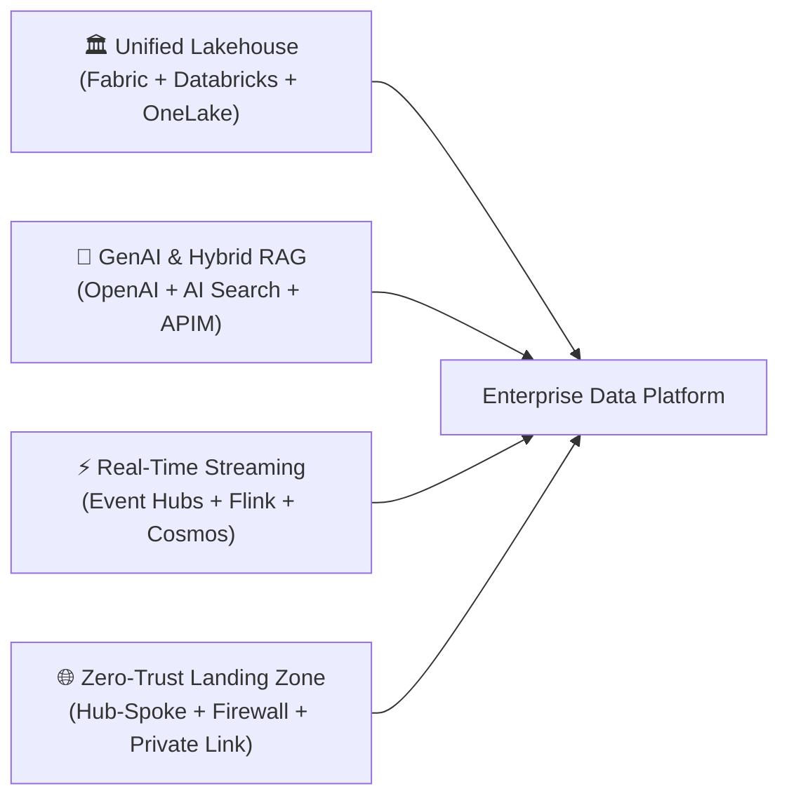

1. [**🏛️ Unified Lakehouse with Microsoft Fabric & Azure Databricks**](architectures/enterprise-lakehouse-fabric.md): Multi-engine Medallion architecture (Bronze ➔ Silver ➔ Gold) unifying OneLake, Delta Lake 3.x, Unity Catalog, and Power BI Direct Lake mode.
2. [**🤖 Enterprise GenAI & Hybrid RAG Platform**](architectures/genai-rag-openai-search.md): Sub-second enterprise RAG leveraging Azure OpenAI (GPT-4o), Azure AI Search (Hybrid BM25 + Vector + Semantic Ranker), Document Intelligence, and API Management rate limiting.
3. [**⚡ High-Throughput Real-Time Streaming & IoT Platform**](architectures/real-time-streaming-iot.md): Ingesting and serving 2,000,000 events/sec via Azure Event Hubs, Apache Flink / Structured Streaming, Azure Cosmos DB, and Fabric Eventhouse.
4. [**🌐 Enterprise Landing Zone & Zero-Trust Hub-Spoke Network**](architectures/enterprise-landing-zone-hub-spoke.md): Microsoft Cloud Adoption Framework (CAF) topology with Azure Firewall Premium (TLS inspection & IDPS), Private DNS Resolvers, and forced tunneling.

---

## 🖼️ Master Whiteboard Architecture Blueprints

The repository includes **52 publication-grade architectural whiteboard blueprints** mirrored under [`assets/whiteboards/`](assets/whiteboards) and cataloged with comprehensive multi-persona breakdowns, failure modes, and engine internals in [`docs/whiteboard_diagrams/README.md`](docs/whiteboard_diagrams/README.md).

- 🖼️ **[Master Whiteboard Blueprints Hub](docs/whiteboard_diagrams/handbook_whiteboard_blueprints.md)**: Complete whiteboard architecture blueprints with storage vs. compute, control vs. data planes, memory tiers, and failure modes.
- 📊 **[Spark Architecture & Tuning Cheatsheet](assets/whiteboards/spark_architecture_catalyst_cheatsheet.jpg)**: High-resolution visual cheatsheet covering cluster topology, Catalyst compiler phases, and memory tiers.
- 🔀 **[Join Strategies Decision Matrix](assets/whiteboards/spark_join_strategies_decision_matrix.jpg)**: Visual flowchart and decision tree for distributed joins and broadcast thresholds.
- ⚡ **[Skew & Memory Spill Triage](assets/whiteboards/spark_performance_skew_spill_triage.jpg)**: Step-by-step diagnostic workflow for data skew, spill to disk, and OOM triage.

### 📐 Visual Blueprints Showcase

<table>
  <tr>
    <td width="50%" valign="top">
      <a href="docs/whiteboard_diagrams/README.md#fabric-onelake-architecture">
        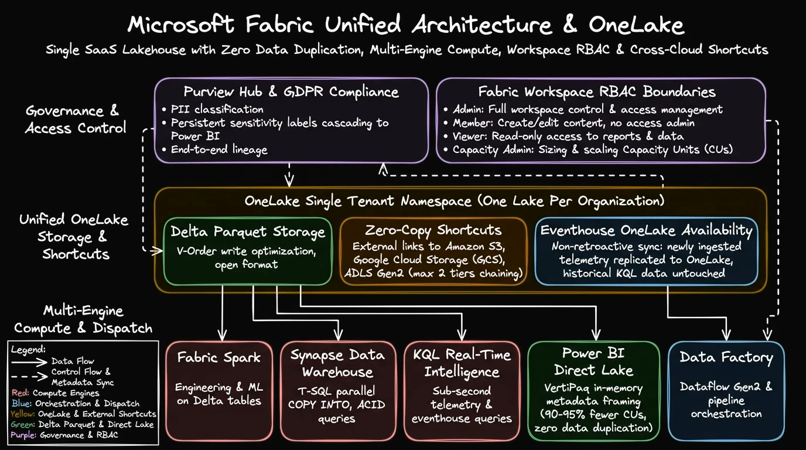
      </a>
      <br><strong>Microsoft Fabric Unified Architecture & OneLake</strong><br>
      <em>Single SaaS lakehouse with zero data duplication, multi-engine compute, and cross-cloud shortcuts.</em>
    </td>
    <td width="50%" valign="top">
      <a href="docs/whiteboard_diagrams/README.md#adf-hybrid-integration-runtime">
        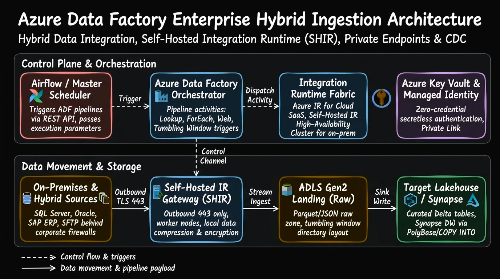
      </a>
      <br><strong>Azure Data Factory Enterprise Hybrid Ingestion Architecture</strong><br>
      <em>Self-hosted integration runtimes, managed virtual networks, and hybrid ingestion topology.</em>
    </td>
  </tr>
  <tr>
    <td width="50%" valign="top">
      <a href="docs/whiteboard_diagrams/README.md#powerbi-direct-lake-vertipaq">
        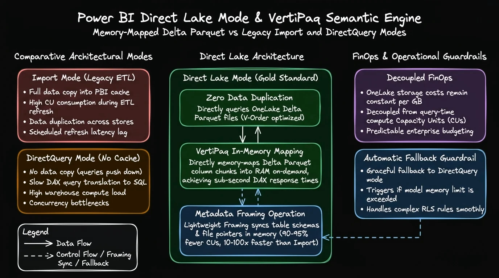
      </a>
      <br><strong>Power BI Direct Lake Mode & VertiPaq Semantic Engine</strong><br>
      <em>Zero-latency semantic model paging directly over OneLake Delta Parquet.</em>
    </td>
    <td width="50%" valign="top">
      <a href="docs/whiteboard_diagrams/README.md#fabric-onelake-direct-lake-architecture">
        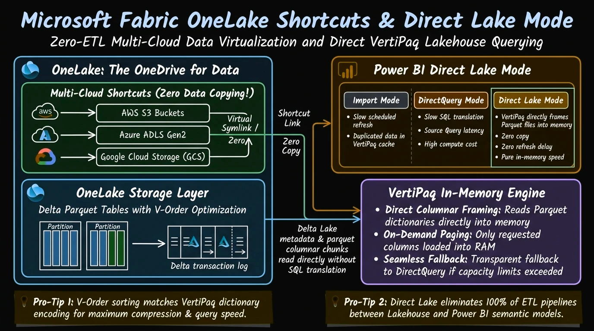
      </a>
      <br><strong>Microsoft Fabric OneLake Shortcuts & Direct Lake Mode</strong><br>
      <em>Cross-cloud storage virtualization linking AWS S3 and ADLS Gen2 with zero egress.</em>
    </td>
  </tr>
  <tr>
    <td width="50%" valign="top">
      <a href="docs/whiteboard_diagrams/README.md#purview-governance-catalog">
        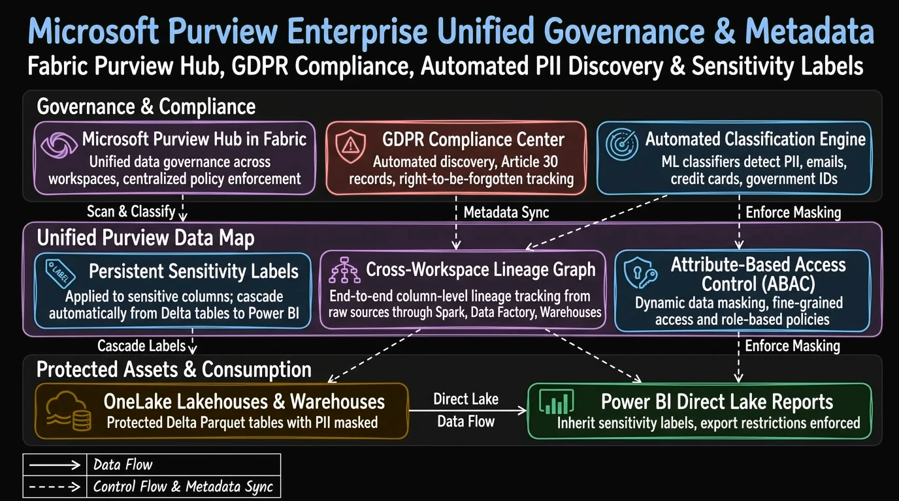
      </a>
      <br><strong>Microsoft Purview Enterprise Governance Architecture</strong><br>
      <em>Automated asset scanning, sensitivity labeling, and cross-platform lineage graphs.</em>
    </td>
    <td width="50%" valign="top">
      <a href="docs/whiteboard_diagrams/README.md#powerbi-dax-engine-context">
        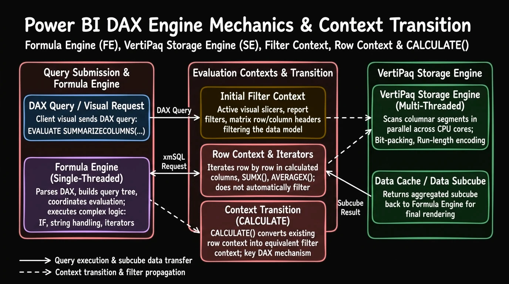
      </a>
      <br><strong>Power BI DAX Engine Mechanics & Context Transition</strong><br>
      <em>Row context, filter context, VertiPaq scan operators, and evaluation flow.</em>
    </td>
  </tr>
  <tr>
    <td width="50%" valign="top">
      <a href="docs/whiteboard_diagrams/README.md#rag-vector-search-data-pipeline">
        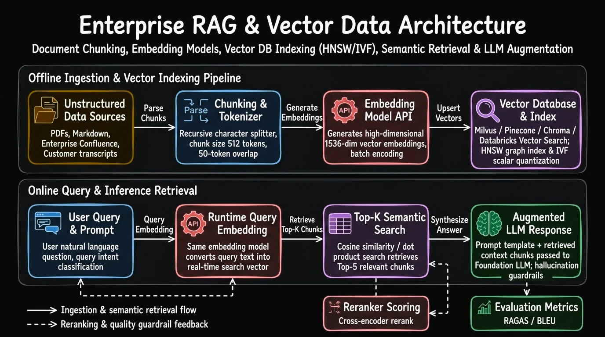
      </a>
      <br><strong>Enterprise RAG & Hybrid Vector Search Architecture</strong><br>
      <em>Chunking, embedding generation, Azure AI Search vector indexing, and grounded LLM synthesis.</em>
    </td>
    <td width="50%" valign="top">
      <a href="docs/whiteboard_diagrams/README.md#lakehouse-bcdr-failover">
        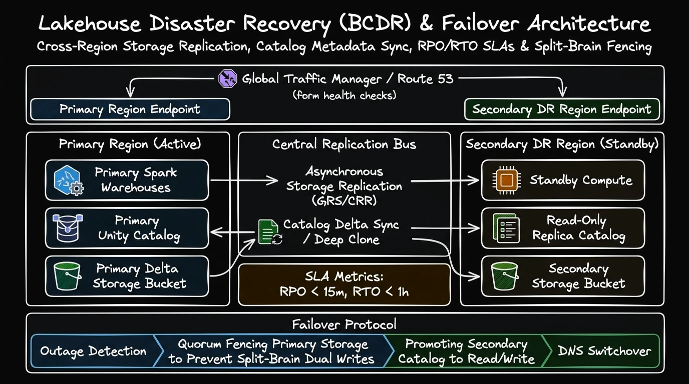
      </a>
      <br><strong>Lakehouse Disaster Recovery (BCDR) Cross-Region Failover</strong><br>
      <em>Active-passive storage replication, DNS failover routing, and split-brain prevention.</em>
    </td>
  </tr>
</table>

> 🔍 **Explore all 52 blueprints with 5-persona breakdowns, failure modes, and engine internals in [docs/whiteboard_diagrams/README.md](docs/whiteboard_diagrams/README.md)**.

## 💻 Interactive CLI Explorer

Explore Azure cheatsheets, architectures, incident runbooks, and interview guides directly from your terminal:

```bash
# Search by keyword or service (e.g. Private Endpoints, Bicep, FinOps)
python scripts/interactive_shell.py "private endpoint"
python scripts/interactive_shell.py bicep

# Browse categories
python scripts/interactive_shell.py --cheatsheets
python scripts/interactive_shell.py --architectures
python scripts/interactive_shell.py --runbooks
python scripts/interactive_shell.py --interview

# Run verification test suite
python scripts/run_tests.py
```

---

## 🚨 Production Incident Runbooks

Six operational disaster recovery runbooks located under `runbooks/`:

| Runbook ID | Title & Direct Link | Severity | Root Cause & Remediation Focus |
| :---: | :--- | :---: | :--- |
| **01** | **[Regional Service Outage & Resource Health Triage](runbooks/01_service_outage_and_resource_health_triage.md)** | `SEV-1` | Detect regional platform outages via CLI, execute global traffic rerouting via Front Door, and trigger secondary paired region failover. |
| **02** | **[VNet Peering & Private Endpoint DNS Failures](runbooks/02_vnet_peering_and_private_endpoint_dns_failures.md)** | `SEV-1` | Triage `NameResolutionFailure`, repair missing Spoke VNet links in central Private DNS Zones, and configure non-transitive peering routes. |
| **03** | **[FinOps Cost Spikes & Orphan Resources](runbooks/03_finops_uncontrolled_cost_spikes_and_orphan_resources.md)** | `SEV-2` | Hunt and eliminate unattached Premium SSD managed disks, release idle public IPs, and enforce automated spending anomaly guardrails. |
| **04** | **[Entra ID RBAC & Key Vault Secret Rotation Disasters](runbooks/04_entra_id_rbac_and_keyvault_secret_rotation_disasters.md)** | `SEV-1` | Triage expired Service Principal credentials (`AADSTS7000222`), resolve Key Vault RBAC permission conflicts, and migrate to Managed Identities. |
| **05** | **[BCDR & Cross-Region Geo-Replication Failover](runbooks/05_bcdr_and_cross_region_geo_replication_failover.md)** | `SEV-1` | Execute customer-initiated storage account failover (GRS/GZRS), trigger Azure SQL failover groups, and manage RPO/RTO data loss windows. |
| **06** | **[AKS Ingress & Network Security Group Lockouts](runbooks/06_aks_ingress_and_network_security_group_lockouts.md)** | `SEV-2` | Resolve `502 Bad Gateway` on Application Gateway Ingress Controller (AGIC), fix health probe paths, and repair missing NSG ingress rules. |

---

## 🎓 4-Tier Interview Preparation Matrix

Comprehensive technical interview guides and flashcard deck located under `interview/`:

| Tier | Role Target | Core Focus Areas | Direct Link |
| :---: | :--- | :--- | :---: |
| **Tier 1** | **Junior Cloud Engineer** | Management Groups, Subscriptions, VNets, Subnets, NSGs, Blob Storage Tiers & Redundancy, VMs, App Services, Entra ID. | [`01_junior.md`](interview/01_junior_cloud_engineer.md) |
| **Tier 2** | **Mid-Level Data & Cloud Engineer** | Azure Data Factory, Fabric OneLake, Azure Databricks, Private Endpoints & DNS, Managed Identities, Bicep IaC, Azure SQL Serverless. | [`02_mid_level.md`](interview/02_mid_level_data_and_cloud_engineer.md) |
| **Tier 3** | **Senior Azure Cloud Architect** | Hub-Spoke Landing Zones, ExpressRoute Failover, Zero Trust Perimeter, Cosmos DB 5 Consistency Levels, Fabric vs Databricks, FinOps. | [`03_senior.md`](interview/03_senior_azure_architect.md) |
| **Tier 4** | **Staff & Principal Solutions Architect** | Multi-Region Active-Active Geo-DR, BCDR, GenAI / Hybrid RAG (OpenAI + AI Search), Sovereign Cloud, Azure Policy at Scale. | [`04_staff.md`](interview/04_staff_and_principal_solutions_architect.md) |
| **Deck** | **50 Rapid-Fire Flashcards** | 50 rapid-fire questions and answers across Core Compute, Networking, Storage, Data, AI, Security, and FinOps (AZ-900 / DP-203 / DP-600 / AZ-305). | [`05_flashcards.md`](interview/05_flashcards_deck_50.md) |

---

## 🔄 Key Service Evolutions & Renaming Index

Azure services continuously evolve. Here is the quick-reference cheat sheet for the most critical recent renames and transitions:

| Former Name | Current / Modern Name | Impact & Technical Upgrades |
| :--- | :--- | :--- |
| **Azure Active Directory (Azure AD)** | [**Microsoft Entra ID**](https://learn.microsoft.com/entra/) | Renamed under Entra portfolio. Unifies Workload Identities, Entra PIM, and Zero Trust access. |
| **Azure Cognitive Search** | [**Azure AI Search**](https://learn.microsoft.com/azure/search/) | Added native Vector Search (HNSW / DiskANN), Hybrid Retrieval, and Semantic Ranker cross-encoder. |
| **Azure Cognitive Services** | [**Azure AI Services / Azure AI Foundry**](https://learn.microsoft.com/azure/ai-studio/) | Unified multi-service APIs, Azure OpenAI integration, and unified AI Studio / Foundry portal. |
| **Azure Synapse Analytics** | [**Microsoft Fabric**](https://learn.microsoft.com/fabric/) | Next-generation unified SaaS platform centered on OneLake and open Delta Parquet format. |
| **Azure Security Center + Defender** | [**Microsoft Defender for Cloud**](https://learn.microsoft.com/azure/defender-for-cloud/) | Unified CSPM and CWPP multi-cloud defense across Azure, AWS, and GCP. |
| **Time Series Insights (TSI)** | [**Azure Data Explorer / Fabric Eventhouse**](https://learn.microsoft.com/azure/data-explorer/) | TSI retired. Real-time time-series telemetry workloads now use KQL-based Eventhouse / ADX. |
| **ADLS Gen1** | [**ADLS Gen2**](https://learn.microsoft.com/azure/storage/blobs/data-lake-storage-introduction) | ADLS Gen1 retired Feb 2024. Gen2 integrates POSIX Hierarchical Namespace directly onto Blob Storage. |
| **PostgreSQL / MySQL Single Server** | [**Azure Database for PostgreSQL / MySQL Flexible**](https://learn.microsoft.com/azure/postgresql/flexible-server/) | Single Server retired. Flexible Server provides zone-redundant HA and `pgvector` AI support. |

*See full details, migration runbooks, and deprecations in the [Service Evolution Guide](cheatsheets/azure-service-map-and-renames.md).*

---

## 🧭 Master Architectural Decision Trees

### 1. Compute Selection Tree

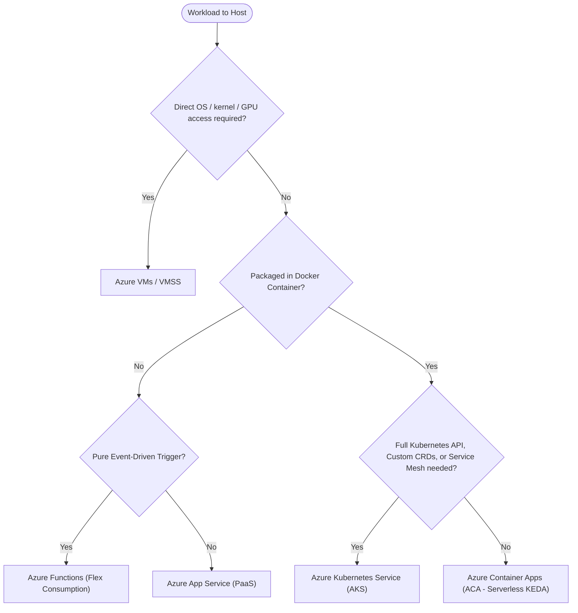

### 2. Database & Storage Selection Tree

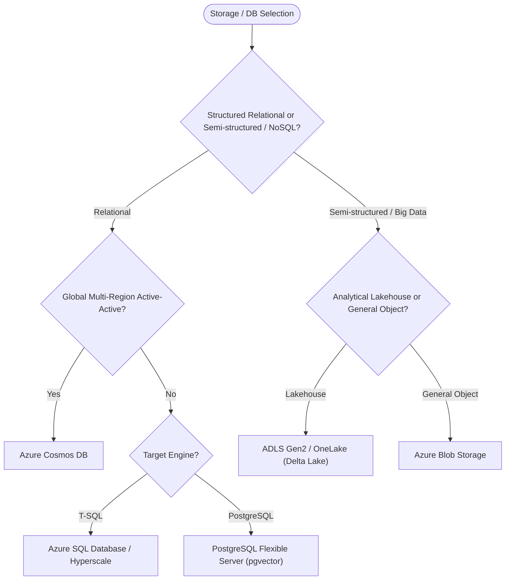

*See full decision matrices in [Architecture Decision Trees & Matrices](cheatsheets/decision-matrices.md).*

---

## 💻 Azure CLI (`az`) Fast Reference

```bash
# 1. Login & Subscription Selection
az login --use-device-code
az account set --subscription "Production-Subscription"

# 2. Deploy Azure Bicep Infrastructure with Preflight Diff
az deployment group what-if -g rg-lakehouse-prod -f main.bicep
az deployment group create -g rg-lakehouse-prod -f main.bicep --parameters @main.bicepparam

# 3. Create ADLS Gen2 Storage (Hierarchical Namespace)
az storage account create -g rg-data -n stlakehouse01 -l eastus \
  --sku Standard_ZRS --kind StorageV2 --enable-hierarchical-namespace true \
  --allow-blob-public-access false

# 4. FinOps: Suspend / Resume Microsoft Fabric Capacity
az fabric capacity suspend -g rg-fabric -n capfabricdev01
az fabric capacity resume  -g rg-fabric -n capfabricdev01

# 5. Tail Live Web App Logs
az webapp log tail -g rg-apps -n app-customer-portal

# 6. Find Unattached Idle Disks (FinOps Triage)
az disk list --query "[?managedBy==null].{Name:name, RG:resourceGroup, GB:diskSizeGb}" -o table
```

*For 150+ comprehensive CLI recipes, visit the [Azure CLI Cheat Sheet](cheatsheets/azure-cli-cheat-sheet.md).*

---

## 💰 The 5 Golden Rules of Azure FinOps

1. **Cover 70% of Baseline Compute with Reservations & Savings Plans**: Combine 3-Year Reserved Instances for fixed stateful databases and Azure Savings Plans for dynamic compute (up to 72% discount).
2. **Auto-Suspend Non-Production Environments**: Schedule Fabric capacities (`az fabric capacity suspend`), Synapse SQL pools, and dev VMs to shut down outside business hours—saving **70% of non-prod compute spend**.
3. **Automate Storage Lifecycle Policies**: Push raw landing data from Hot ➔ Cool after 30 days, Cold after 90 days, and Archive after 365 days (saving up to 95% on historical storage).
4. **Purge Orphaned Cloud Assets Monthly**: Continuously run scripts to delete unattached Managed Disks, idle Public IPs, and orphaned snapshots.
5. **Utilize Spot Instances for Batch & Fault-Tolerant Streaming**: Run ephemeral Spark worker pools on Spot VMs (up to 90% discount) with Azure Scheduled Events API eviction handlers.

*Read the full guide in the [FinOps & Cost Optimization Runbook](cheatsheets/finops-and-cost-optimization.md).*

---

## 🎓 Azure Certification Roadmap

| Certification | Code | Target Role | Key Knowledge Domains |
| :--- | :--- | :--- | :--- |
| **Azure Fundamentals** | `AZ-900` | Beginners, Sales, Managers | Cloud concepts, core Azure services, security, pricing, SLA. |
| **Azure Administrator Associate** | `AZ-104` | SysAdmins, Cloud Engineers | Virtual networking, compute, storage, Entra ID, governance, monitoring. |
| **Azure Developer Associate** | `AZ-204` | Software Engineers | Azure Functions, Container Apps, Cosmos DB, Blob, Key Vault, APIM, Event Grid. |
| **Azure Solutions Architect Expert** | `AZ-305` | Enterprise Architects | Design identity, governance, monitoring, data storage, business continuity, infra. |
| **Azure DevOps Engineer Expert** | `AZ-400` | DevOps / SRE Engineers | CI/CD pipelines, Bicep/Terraform, dependency management, security compliance. |
| **Azure Data Engineer Associate** | `DP-203` | Data Engineers | Data Factory, Synapse, Databricks, ADLS Gen2, stream processing, security. |
| **Fabric Analytics Engineer Associate** | `DP-600` | Analytics Engineers | Microsoft Fabric OneLake, Lakehouse, Warehouse, Direct Lake, DAX, PySpark. |
| **Azure AI Engineer Associate** | `AI-102` | AI Engineers | Azure OpenAI, Azure AI Search, Document Intelligence, Computer Vision, Speech. |
| **Cybersecurity Architect Expert** | `SC-100` | Security Architects | Zero Trust strategy, Microsoft Defender for Cloud, Microsoft Sentinel, Purview. |

---

## 🖼️ Downloadable Visual Posters & Cheat Sheets

> [!NOTE]
> **The original downloadable posters below were produced in August 2022 and have not been regenerated since.**
> They predate several major renames — Azure Active Directory is now Microsoft Entra ID, Cognitive Services is now Azure AI Services, Windows Virtual Desktop is now Azure Virtual Desktop — and they show some services that have since retired. For current information, use the [interactive version](https://azurecheatsheet.com) and the updated [text listings below](#-complete-azure-services--products-catalog).

### One-Page Visual Sheet (August 2022)
- **White background**: [High-Res PNG](1_page_version/LightSheet/Azure_developers_sheet_light-high_rez.png) | [Medium-Res PNG](1_page_version/LightSheet/Azure_developers_sheet_light-mid_rez.png) | [PDF](1_page_version/LightSheet/Azure_Developers_sheet-light.pdf) | [SVG](1_page_version/LightSheet/Azure_Developers_sheet-light.svg)
- **Dark background**: [High-Res PNG](1_page_version/DarkSheet/Azure_developers_sheet_dark-high_rez.png) | [Medium-Res PNG](1_page_version/DarkSheet/Azure_developers_sheet_dark-mid_rez.png) | [PDF](1_page_version/DarkSheet/Azure_Developers_sheet-dark.pdf) | [SVG](1_page_version/DarkSheet/Azure_Developers_sheet-dark.svg)

<p align="center">
  <a target="_blank" href="1_page_version/DarkSheet/Azure_developers_sheet_dark-mid_rez.png">
    
  </a>
</p>

### Two-Page Visual Sheet (August 2022)
- **White background**: [Page 1 High-Res](2_page_version/LightSheet/High/Azure-document-light-1st-page-highrez.png) | [Page 2 High-Res](2_page_version/LightSheet/High/Azure-document-light-2nd-page-highrez.png) | [PDF](2_page_version/LightSheet/Azure_Developers_2_page_sheet_light.pdf)
- **Dark background**: [Page 1 High-Res](2_page_version/DarkSheet/High/Azure-document-dark-1st-page-highrez.png) | [Page 2 High-Res](2_page_version/DarkSheet/High/Azure-document-dark-2nd-page-highrez.png) | [PDF](2_page_version/DarkSheet/Azure_Developers_2_page_sheet_dark.pdf)

### Bonus Cheat Sheets
- **Azure Cloud Services Cheat Sheet (May 2024)**: [View Image](Azure-Cloud-services-cheat-sheet.png) • [Download PDF](Azure-Cloud-Services-cheat-sheet.pdf)
- **Azure Load Balancers Cheat Sheet (June 2024)**: [View Image](Azure-load-balancer---cheat-sheet.png) • [Download PDF](Azure-load-balancer-cheat-sheet.pdf)

---

## 📦 Complete Azure Services & Products Catalog

*Directly verified against Microsoft Learn and Azure Product Catalog.*

### 1. Compute

* [**Azure App Service**](https://azure.microsoft.com/en-gb/products/app-service/): Quickly create and host powerful cloud apps and REST APIs for web and mobile.
* [**Azure Container Apps (ACA)**](https://azure.microsoft.com/en-gb/products/container-apps/): Fully managed serverless container runtime powered by Kubernetes, KEDA, Envoy, and Dapr.
* [**Azure Kubernetes Service (AKS)**](https://azure.microsoft.com/en-gb/products/kubernetes-service/): Production-grade managed Kubernetes with Azure CNI Overlay, Cilium network policies, and Karpenter autoscaling.
* [**Azure Functions**](https://azure.microsoft.com/en-gb/products/functions/): Execute event-driven serverless code with the high-performance Flex Consumption tier.
* [**Virtual Machines**](https://azure.microsoft.com/en-gb/products/virtual-machines/): Provision Windows and Linux virtual machines in seconds with Intel, AMD, and ARM processors.
* [**Virtual Machine Scale Sets (VMSS)**](https://azure.microsoft.com/en-gb/products/virtual-machine-scale-sets/): Manage and scale up to thousands of Linux and Windows VMs with Flexible orchestration.
* [**Azure Spot Virtual Machines**](https://azure.microsoft.com/en-gb/products/virtual-machines/spot/): Provision unused compute capacity at up to 90% discount for interruptible workloads.
* [**Azure Dedicated Host**](https://azure.microsoft.com/en-gb/products/virtual-machines/dedicated-host/): Physical servers dedicated to your organization's Azure VMs for compliance and hardware isolation.
* [**Azure Confidential VMs**](https://azure.microsoft.com/en-gb/solutions/confidential-compute/): Hardware-based isolation with confidential computing (AMD SEV-SNP / Intel TDX) for sensitive data.
* [**Batch**](https://azure.microsoft.com/en-gb/products/batch/): Cloud-scale parallel job scheduling and compute management.
* [**Static Web Apps**](https://azure.microsoft.com/en-gb/products/app-service/static/): Streamlined full-stack web hosting from Git repositories to global high availability.
* [**Azure Virtual Desktop**](https://azure.microsoft.com/en-gb/products/virtual-desktop/): Deliver secure, remote Windows 10/11 desktops and virtual apps to any device.
* [**Microsoft Dev Box**](https://azure.microsoft.com/en-gb/products/dev-box/): High-performance, self-service cloud workstations preconfigured and ready to code.
* [**Azure Deployment Environments**](https://azure.microsoft.com/en-gb/products/deployment-environments/): Enable developers to spin up secure app infrastructure environments using project-based templates.
* [**Azure Compute Fleet**](https://azure.microsoft.com/en-gb/products/compute-fleet/): Centrally manage and deploy mixed VM types, Spot instances, and zones for high availability at scale.
* [**Azure Spring Apps**](https://azure.microsoft.com/en-gb/products/spring-apps): Fully managed Spring Boot app hosting from Microsoft and VMware (retires 31 March 2028; migrate to ACA or AKS).

---

### 2. Artificial Intelligence & Machine Learning

* [**Azure AI Foundry**](https://learn.microsoft.com/azure/ai-studio/): Enterprise platform for discovering, customizing, evaluating, and deploying generative AI and agents at scale.
* [**Azure OpenAI Service**](https://learn.microsoft.com/azure/ai-services/openai/): Enterprise-grade access to cutting-edge models (GPT-4o, GPT-4o mini, o1, o3-mini, DALL-E 3, Whisper) with VNet security.
* [**Azure AI Search**](https://azure.microsoft.com/en-gb/products/ai-services/ai-search/): Enterprise retrieval engine powering RAG with Hybrid Search (dense vector + BM25 keyword) and Semantic Ranker.
* [**Azure AI Document Intelligence**](https://azure.microsoft.com/en-gb/products/ai-services/ai-document-intelligence/): Advanced OCR extracting layout, tables, key-value pairs, and Markdown from documents and PDFs.
* [**Azure AI Content Safety**](https://azure.microsoft.com/en-gb/products/ai-services/ai-content-safety/): AI moderation detecting prompt injection attacks, jailbreaks, toxicity, and sensitive data leaks.
* [**Azure Machine Learning**](https://azure.microsoft.com/en-gb/products/machine-learning/): Comprehensive MLOps platform for training, fine-tuning, MLflow registry tracking, and deploying custom models.
* [**Azure AI Speech**](https://azure.microsoft.com/en-gb/products/ai-services/ai-speech/): Highly accurate speech-to-text, natural text-to-speech, translation, and speaker identification.
* [**Azure AI Vision**](https://azure.microsoft.com/en-gb/products/ai-services/ai-vision/): Computer vision for image analysis, spatial analysis, face verification, and multi-modal vector embeddings.
* [**Azure AI Language**](https://azure.microsoft.com/en-gb/products/ai-services/ai-language/): Natural language processing for sentiment analysis, entity extraction, PII redaction, and summarization.
* [**Azure AI Video Indexer**](https://azure.microsoft.com/en-gb/products/ai-video-indexer/): Extract actionable visual and audio insights from video files.

---

### 3. Analytics & Big Data

* [**Microsoft Fabric**](https://learn.microsoft.com/fabric/): End-to-end SaaS analytics platform unifying OneLake, Lakehouse, Data Warehouse, Real-Time Intelligence, and Data Factory.
* [**Azure Databricks**](https://azure.microsoft.com/en-gb/products/databricks/): Collaborative data and AI platform powered by Apache Spark, Photon, Delta Lake 3.x, and Unity Catalog.
* [**Azure Synapse Analytics**](https://azure.microsoft.com/en-gb/products/synapse-analytics/): Enterprise data platform integrating Massively Parallel Processing (MPP) Dedicated SQL Pools, Serverless SQL, and Spark.
* [**Azure Data Factory (ADF)**](https://azure.microsoft.com/en-gb/products/data-factory/): Cloud-scale hybrid ETL/ELT service with 100+ native connectors and Self-Hosted Integration Runtimes.
* [**Azure Data Explorer (ADX / Kusto)**](https://azure.microsoft.com/en-gb/products/data-explorer/): Ultra-fast time-series and log analytics query engine powered by Kusto Query Language (KQL).
* [**Azure Event Hubs**](https://azure.microsoft.com/en-gb/products/event-hubs/): Fully managed big data streaming platform supporting native Kafka protocols and Schema Registry.
* [**Azure Stream Analytics**](https://azure.microsoft.com/en-gb/products/stream-analytics/): Real-time complex event processing engine executing declarative SQL queries over streaming telemetry.
* [**Microsoft Purview**](https://www.microsoft.com/security/business/compliance/microsoft-purview): Unified data governance platform offering automated cataloging, sensitive data discovery, and lineage mapping.

---

### 4. Databases

* [**Azure Cosmos DB**](https://azure.microsoft.com/en-gb/products/cosmos-db/): Globally distributed, multi-model NoSQL and relational database with guaranteed single-digit millisecond latency and vector indexing.
* [**Azure SQL Database**](https://azure.microsoft.com/en-gb/products/azure-sql/database/): Fully managed relational database built on SQL Server with Serverless auto-pause and Hyperscale scaling up to 100TB.
* [**Azure SQL Managed Instance**](https://azure.microsoft.com/en-gb/products/azure-sql/managed-instance/): Cloud SQL Server with near 100% compatibility with on-premises instances and native VNet integration.
* [**Azure Database for PostgreSQL - Flexible Server**](https://azure.microsoft.com/en-gb/products/postgresql/): Managed PostgreSQL with zone-redundant HA, connection pooling (PgBouncer), and native `pgvector` support.
* [**Azure Database for MySQL - Flexible Server**](https://azure.microsoft.com/en-gb/products/mysql/): High-performance managed MySQL offering custom maintenance windows and IOPS autoscaling.
* [**Azure Managed Redis & Azure Cache for Redis**](https://azure.microsoft.com/en-gb/products/azure-cache-for-redis/): Ultra-fast in-memory data store for caching, session management, vector search, and pub/sub.

---

### 5. Storage

* [**Azure Data Lake Storage Gen2 (ADLS Gen2)**](https://learn.microsoft.com/azure/storage/blobs/data-lake-storage-introduction): Massively scalable object lakehouse storage featuring a true POSIX-compliant Hierarchical Namespace (HNS).
* [**Azure Blob Storage**](https://azure.microsoft.com/en-gb/products/storage/blobs/): Highly durable object storage with automated lifecycle management across Hot, Cool, Cold, and Archive tiers.
* [**Azure Files**](https://azure.microsoft.com/en-gb/products/storage/files/): Enterprise cloud file shares accessible via standard Server Message Block (SMB) and Network File System (NFS).
* [**Azure NetApp Files (ANF)**](https://azure.microsoft.com/en-gb/products/netapp/): Ultra-high performance, sub-millisecond latency enterprise file storage powered by NetApp ONTAP.
* [**Azure Managed Disks**](https://azure.microsoft.com/en-gb/products/storage/disks/): High-performance block storage volumes attached to Azure VMs (Ultra Disk, Premium SSD v2, Standard SSD).

---

### 6. Networking

* [**Azure Virtual Network (VNet)**](https://azure.microsoft.com/en-gb/products/virtual-network/): Fundamental building block for private networking, subnets, peering, and micro-segmentation.
* [**Azure Private Link & Private Endpoints**](https://azure.microsoft.com/en-gb/products/private-link/): Secure private connectivity from your VNet directly to Azure PaaS services, eliminating public internet exposure.
* [**Azure Front Door**](https://azure.microsoft.com/en-gb/products/frontdoor/): Global Layer 7 entry-point delivering unified CDN caching, edge Web Application Firewall (WAF), and anycast acceleration.
* [**Azure Application Gateway**](https://azure.microsoft.com/en-gb/products/application-gateway/): Regional Layer 7 web traffic load balancer and reverse proxy equipped with integrated OWASP WAF.
* [**Azure Load Balancer**](https://azure.microsoft.com/en-gb/products/load-balancer/): Ultra-low latency Layer 4 (TCP/UDP) inbound and outbound load balancing for VMs and container clusters.
* [**Azure Firewall Premium**](https://azure.microsoft.com/en-gb/products/azure-firewall/): Cloud-native stateful network firewall with TLS inspection, Intrusion Detection and Prevention (IDPS), and URL filtering.
* [**Azure Bastion**](https://azure.microsoft.com/en-gb/products/azure-bastion/): Secure, agentless browser-based RDP and SSH access to VMs without exposing public IP addresses.
* [**Azure ExpressRoute**](https://azure.microsoft.com/en-gb/products/expressroute/): Dedicated private high-bandwidth connection between on-premises datacenters and Azure cloud.
* [**Azure Virtual WAN (vWAN)**](https://azure.microsoft.com/en-gb/products/virtual-wan/): Unified global networking hub aggregating site-to-site VPN, point-to-site VPN, and ExpressRoute.
* [**Azure DNS Private Resolver**](https://learn.microsoft.com/azure/dns/dns-private-resolver-overview): Fully managed DNS forwarding service bridging on-premises DNS servers with Azure Private DNS zones.

---

### 7. Security & Identity

* [**Microsoft Entra ID**](https://learn.microsoft.com/entra/): Enterprise identity and access management delivering Conditional Access, passwordless sign-in, MFA, and Workload Identity Federation.
* [**Microsoft Entra PIM**](https://learn.microsoft.com/entra/id-governance/privileged-identity-management/pim-configure): Just-in-time, approval-based role activation for administrative privileges to eliminate persistent standing access.
* [**Azure Key Vault**](https://azure.microsoft.com/en-gb/products/key-vault/): Centralized store for safeguarding cryptographic keys, secrets, and TLS certificates with RBAC enforcement and purge protection.
* [**Microsoft Defender for Cloud**](https://www.microsoft.com/security/business/cloud-security/microsoft-defender-for-cloud): Cloud Security Posture Management (CSPM) and Workload Protection auditing against CIS, NIST, and ISO standards.
* [**Microsoft Sentinel**](https://www.microsoft.com/security/business/siem-and-xdr/microsoft-sentinel): Cloud-native Security Information and Event Management (SIEM) and Security Orchestration, Automation, and Response (SOAR).
* [**Azure Policy**](https://azure.microsoft.com/en-gb/products/azure-policy/): Enforce organizational standards, guardrails, and compliance across subscriptions at scale with automated remediation.

---

### 8. DevOps & Developer Tooling

* [**Azure Bicep**](https://learn.microsoft.com/azure/azure-resource-manager/bicep/): Modern, domain-specific language (DSL) for deploying declarative Azure infrastructure without raw ARM JSON boilerplate.
* [**Azure Developer CLI (`azd`)**](https://learn.microsoft.com/azure/developer/azure-developer-cli/): Open-source CLI accelerating developer inner-loop workflows from local code to cloud deployment in a single command (`azd up`).
* [**Azure DevOps Services**](https://azure.microsoft.com/en-gb/products/devops/): Enterprise collaboration tools including Azure Repos, Pipelines, Boards, Artifacts, and Test Plans.
* [**Azure Monitor & Log Analytics**](https://azure.microsoft.com/en-gb/products/monitor/): Comprehensive full-stack observability suite aggregating telemetry, distributed traces, and metrics into a Kusto repository.
* [**Azure Application Insights**](https://learn.microsoft.com/azure/azure-monitor/app/app-insights-overview): Application Performance Monitoring (APM) tracking live HTTP requests, unhandled exceptions, and database dependencies.

---

### 9. Integration & Messaging

* [**Azure API Management (APIM)**](https://azure.microsoft.com/en-gb/products/api-management/): Enterprise API gateway offering token bucket rate limiting, JWT validation, developer portals, and multi-region failover.
* [**Azure Service Bus**](https://azure.microsoft.com/en-gb/products/service-bus/): Fully managed enterprise message broker featuring message queues, publish-subscribe topics, FIFO sessions, and dead-letter queues.
* [**Azure Event Grid**](https://azure.microsoft.com/en-gb/products/event-grid/): Serverless event routing service connecting Azure resources and custom webhooks with CloudEvents compliance.
* [**Azure Logic Apps**](https://azure.microsoft.com/en-gb/products/logic-apps/): Visual low-code workflow orchestration platform connecting 400+ SaaS applications, ERPs, and cloud services.
* [**Azure SignalR Service**](https://azure.microsoft.com/en-gb/products/signalr-service/): Fully managed real-time bidirectional WebSocket service for pushing live updates to web and mobile apps.

---

### 10. Web & Mobile

* [**App Service**](https://azure.microsoft.com/en-gb/products/app-service/): Quickly create and host powerful cloud apps and REST APIs for web and mobile.
* [**Static Web Apps**](https://azure.microsoft.com/en-gb/products/app-service/static/): Streamlined full-stack web hosting from Git repositories to global high availability.
* [**Azure Web PubSub**](https://azure.microsoft.com/en-gb/products/web-pubsub/): Build real-time messaging web applications using WebSockets and publish-subscribe patterns.
* [**Azure Communication Services**](https://azure.microsoft.com/en-gb/products/communication-services/): Build voice, video, chat, SMS, and email communication experiences using the same secure platform backing Microsoft Teams.
* [**Notification Hubs**](https://azure.microsoft.com/en-gb/products/notification-hubs/): Scalable mobile push notification engine broadcasting to iOS, Android, and Windows.

---

### 11. Hybrid & Multicloud

* [**Azure Arc**](https://azure.microsoft.com/en-gb/products/azure-arc/): Extend Azure Resource Manager (ARM), policies, and Defender security governance to on-premises servers, Kubernetes clusters, and AWS/GCP resources.
* [**Azure Stack HCI**](https://azure.microsoft.com/en-gb/products/azure-stack/hci/): Hyperconverged infrastructure (HCI) software solution running virtualized Windows and Linux workloads on validated on-premises hardware.
* [**Azure Edge Zones**](https://azure.microsoft.com/en-gb/solutions/edge-computing/): Connect Azure services directly to mobile operators' 5G networks for sub-10ms edge latency.

---

### 12. Management & Governance

* [**Azure Cost Management**](https://azure.microsoft.com/en-gb/products/cost-management/): Monitor, allocate, and optimize cloud costs across subscriptions with budgets and automated alerts.
* [**Azure Advisor**](https://azure.microsoft.com/en-gb/products/advisor/): Personalized cloud consultant analyzing infrastructure to recommend cost, security, reliability, and performance enhancements.
* [**Azure Resource Manager (ARM)**](https://learn.microsoft.com/azure/azure-resource-manager/management/overview): Central deployment and management service for Azure, providing control-plane access, locks, and tags.
* [**Azure Service Health**](https://azure.microsoft.com/en-gb/features/service-health/): Personalized dashboard notifying you of Azure service outages, planned maintenance, and health advisories affecting your resources.

---

### 13. Internet of Things (IoT)

* [**Azure IoT Hub**](https://azure.microsoft.com/en-gb/products/iot-hub/): Secure and reliable bidirectional communication between millions of IoT devices and a cloud-hosted solution backend.
* [**Azure IoT Edge**](https://azure.microsoft.com/en-gb/products/iot-edge/): Deploy cloud intelligence and custom logic to run directly on cross-platform IoT edge devices.
* [**Azure Digital Twins**](https://azure.microsoft.com/en-gb/products/digital-twins/): Model physical environments and create comprehensive digital twins of smart factories, buildings, and energy grids.

---

## ☕ Support the Project

If you find this cheat sheet and architectural repository valuable:
- Star this repository ⭐ to help others discover it.
- Support original founder Dr. Milan Milanović on Patreon:

[](https://www.patreon.com/techworld_with_milan)

---

## 🤝 Authors & Acknowledgments

- **Modern Architecture Lead & Maintainer**: [**Santosh Jammi**](https://github.com/santoshjammi29) – Enterprise Lakehouse Architect & Lead Author at [Lakehouse Architect](https://santoshjammi.in).  
  Connect: [LinkedIn](https://www.linkedin.com/in/santoshjammi29/) • [X (@SANt0shJ)](https://x.com/SANt0shJ) • [Website](https://santoshjammi.in)
- **Original Foundation**: [Dr. Milan Milanović](https://milan.milanovic.org) – Original author of the visual cheat sheets and creator of [azurecheatsheet.com](https://azurecheatsheet.com).

### 🌐 Ecosystem Interlinking & Sister Repositories

The Modern Data Engineering Lakehouse Ecosystem is an integrated suite of 14 production-grade, specialized repositories anchored by the **[Modern Data Engineer Platform (`moderndataengineer.uk`)](https://github.com/santoshjammi29/moderndataengineer)**. Use this cross-reference matrix to navigate directly between complementary implementations across our repositories:

| Repository | Focus & Domain | Tightly Coupled Cross-Reference & Integration Points |
| :--- | :--- | :--- |
| **[Azure Databricks Blueprints](https://github.com/santoshjammi29/azure-databricks-project-blueprints)** | 3 Enterprise Reference Architectures | • **Azure Landing Zones & VNet Peering**: Reference implementations running Azure Databricks clusters in secure hub-spoke VNets.<br>• **Real-Time Fraud & Event Hubs**: Azure Event Hubs streaming into Delta Lake with off-heap RocksDB state stores. |
| **[The Databricks Handbook](https://github.com/santoshjammi29/databricks-handbook)** | 105 Databricks Production Recipes & Unity Catalog | • **Unity Catalog on ADLS Gen2**: Securable storage credentials and external locations configured against Azure Data Lake Storage.<br>• **DABs CI/CD**: Azure DevOps pipelines deploying Databricks Asset Bundles using Service Principals. |
| **[The PySpark Handbook](https://github.com/santoshjammi29/pyspark-handbook)** | Apache Spark 3.5+, Catalyst & Arrow UDFs | • **Fabric Spark vs Classic Spark**: Tuning vectorized execution, memory pools, and Arrow optimization in Microsoft Fabric notebooks.<br>• **Partition & Spill Triage**: Eliminating shuffle spills across distributed Azure compute. |
| **[The SQL Handbook](https://github.com/santoshjammi29/sql-handbook)** | Relational Query Engines, MPP & Concurrency | • **Synapse Dedicated SQL vs Fabric DW**: Comparing distributed MPP hash distributions with Fabric OneLake columnar tables.<br>• **Direct Lake T-SQL Endpoints**: Querying Delta tables directly without provisioning dedicated compute clusters. |
| **[The dbt Handbook](https://github.com/santoshjammi29/dbt-handbook)** | Analytics Engineering, dbt Mesh & Contracts | • **dbt-synapse & dbt-fabric**: Orchestrating enterprise analytics models on Azure data platforms with automated testing.<br>• **Semantic Layer**: Integrating dbt semantic metrics into Power BI semantic models. |
| **[Streaming Handbook](https://github.com/santoshjammi29/streaming-handbook)** | Kafka KRaft, Apache Flink & Event Architecture | • **Azure Event Hubs Kafka Surface**: Ingesting high-throughput telemetry using Kafka clients targeting Azure Event Hubs namespaces.<br>• **Eventhouse & KQL**: Materializing real-time streams into OneLake Delta Parquet. |
| **[DataOps & CI/CD Handbook](https://github.com/santoshjammi29/dataops-cicd-handbook)** | GitOps, Terraform & Bicep IaC, Platform Engineering | • **Bicep & ARM Templates**: Production Infrastructure-as-Code modules for provisioning Fabric workspaces, ADF, and Key Vault.<br>• **Azure DevOps Pipelines**: Multi-stage promotion pipelines with automated WAP circuit breakers. |
| **[System Design Handbook](https://github.com/santoshjammi29/data-system-design-handbook)** | Distributed Storage, Table Formats & BCDR | • **OneLake Shortcuts & Delta Parquet**: Virtualizing cross-cloud storage (S3/GCS) with zero data movement or egress fees.<br>• **BCDR Failover**: Cross-region ADLS Gen2 replication and paired-region failover strategies. |
| **[Banking Risk Lakehouse](https://github.com/santoshjammi29/enterprise-banking-risk-alm-lakehouse)** | Regulated Financial Lakehouse (BCBS 239 & IFRS 9) | • **Purview Governance & Compliance**: Enforcing EU banking sensitivity labels, automated PII discovery, and audit lineage.<br>• **Private Endpoints**: Zero-trust network isolation for financial calculation engines. |
| **[Spark Experiments](https://github.com/santoshjammi29/spark-experiments)** | Empirical Skew, Salting & Spill Laboratory | • **Fabric Spark Benchmarks**: Validating AQE Skew Join efficiency and two-phase salting under heavy data skew.<br>• **Memory Allocation**: Benchmarking executor heap memory and off-heap limits. |
| **[Interview Handbook](https://github.com/santoshjammi29/data-engineering-interview-handbook)** | Architectural Defense Playbooks & Concepts | • **Azure & Fabric Defense**: Architectural defense scenarios for OneLake, Direct Lake, Synapse DW, and Purview governance.<br>• **20 Knowledge Pillars**: Multi-plane architectural blueprints covering Azure data ecosystems. |
| **[The Security Handbook](https://github.com/santoshjammi29/security-handbook)** | Enterprise Cloud Security, Zero Trust & Lakehouse Governance | • **Zero Trust Lakehouse Perimeter**: Private endpoints, NSGs, and Azure Key Vault envelope encryption.<br>• **Workload Identity Federation**: Keyless GitHub Actions OIDC and Azure Managed Identities. |
| **[Modern Data Engineer Hub](https://github.com/santoshjammi29/moderndataengineer)** | Central Edge Presentation Platform | • **Interactive Whiteboard Viewer**: Pan, zoom, and inspect all 52 blueprints at [moderndataengineer.uk/whiteboards](https://moderndataengineer.uk/whiteboards).<br>• **Cheat Sheets Hub**: Interactive cheat sheets and vector A4 PDF downloads. |


## 📜 License

This work is licensed under a [Creative Commons Attribution 4.0 International License (CC BY 4.0)](https://creativecommons.org/licenses/by/4.0/).
