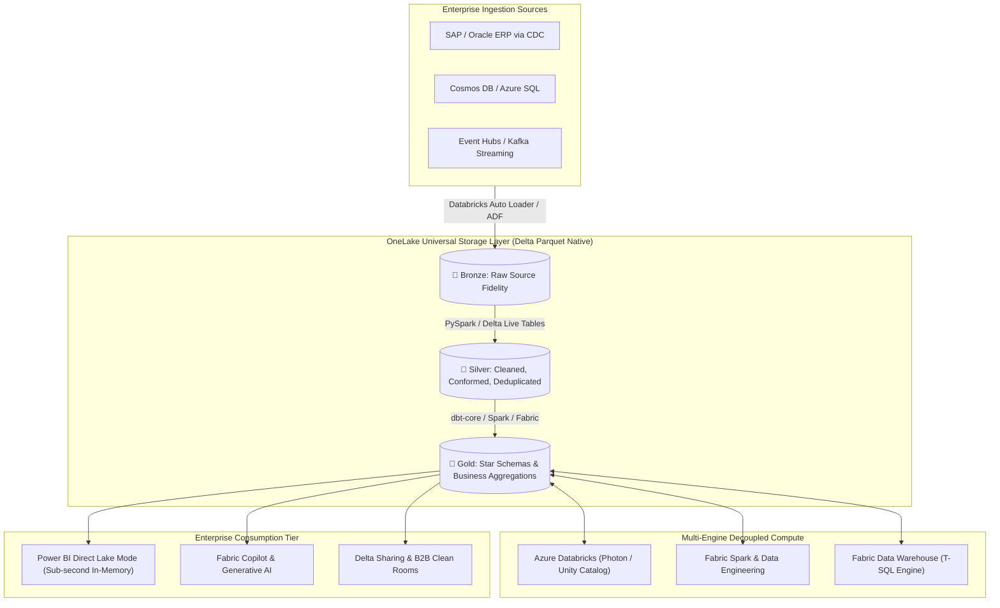
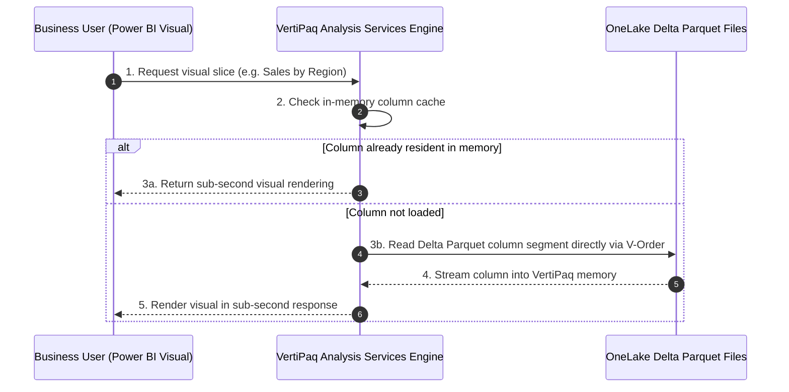

# 🏛️ Architecture Blueprint: Enterprise Unified Lakehouse with Microsoft Fabric & Azure Databricks

A production-tested blueprint for architecting a multi-engine, enterprise-grade Lakehouse unifying **Microsoft Fabric OneLake**, **Azure Databricks with Unity Catalog**, and **Power BI Direct Lake mode**.

---

## 📑 Table of Contents
1. [Executive Summary & Problem Statement](#1-executive-summary--problem-statement)
2. [Target Architecture Diagram](#2-target-architecture-diagram)
3. [Data Flow & Medallion Lifecycle](#3-data-flow--medallion-lifecycle)
4. [5-Persona Operational Responsibility Model](#4-5-persona-operational-responsibility-model)
5. [Under-the-Hood Engine Mechanics](#5-under-the-hood-engine-mechanics)
6. [Production Triage & Incident Runbook](#6-production-triage--incident-runbook)

---

## 1. Executive Summary & Problem Statement

Modern enterprise data organizations struggle with fragmented architectures: separate copies of data for BI reporting, independent ETL compute clusters, divergent security policies, and high data movement egress costs.

This architecture establishes a **single unified Delta Lake storage foundation** accessible simultaneously by:
- **Azure Databricks** (heavy PySpark batch processing, complex ML, and streaming ETL).
- **Microsoft Fabric** (ad-hoc SQL queries, data warehousing, and business analyst pipelines).
- **Power BI** (sub-second semantic model reporting via **Direct Lake mode** with zero import caching).

---

## 2. Target Architecture Diagram



---

## 3. Data Flow & Medallion Lifecycle

### 🥉 Bronze Tier (Raw Landing & Append-Only)
- **Ingestion**: Continuous streaming via Databricks Auto Loader (`cloudFiles`) or Azure Data Factory CDC.
- **Format**: Append-only Delta Lake with schema inference and evolution enabled.
- **Rescue Data**: Corrupt JSON rows quarantined automatically into `_rescued_data` column without crashing ingestion pipelines.

### 🥈 Silver Tier (Cleaned & Conformed)
- **Transformations**: Deduplication using watermark-based lookups, schema validation, datatype casting, and PII masking.
- **ACID Operations**: Idempotent `MERGE INTO` statement handling SCD Type 1 updates and SCD Type 2 historical tracking.
- **Liquid Clustering**: Partitioning optimized via Delta Lake Liquid Clustering (`CLUSTER BY (tenant_id, event_date)`).

### 🥇 Gold Tier (Business Star Schema)
- **Modeling**: Dimensional Kimball star schemas (Fact and Dimension tables).
- **Optimization**: Files compacted to 128MB–512MB Parquet chunks with **V-Order** enabled for blistering VertiPaq memory loading.

---

## 4. 5-Persona Operational Responsibility Model

| Role | Key Focus & Primary Responsibilities | Daily Tooling |
| :--- | :--- | :--- |
| **Lead Architect** | Overall platform topology, capacity sizing (F-SKU / DBU), Zero Trust landing zones, and cost governance. | Azure Portal, Cost Management, Bicep/Terraform |
| **Senior Data Engineer** | Medallion transformation pipelines, stream-batch joins, ACID merge logic, and Liquid Clustering. | Databricks Asset Bundles (DABs), VS Code, PySpark |
| **Data Engineer** | Source ingestion connectors, CDC change tracking, pipeline alerting, and unit testing. | Azure Data Factory, dbt-core, GitHub Actions |
| **Data Steward** | Centralized data cataloging, sensitivity labels, column masking, and regulatory compliance. | Microsoft Purview, Unity Catalog Metastore |
| **Business Analyst** | Direct Lake semantic modeling, executive dashboard design, DAX measures, and ad-hoc SQL querying. | Power BI Desktop, Fabric SQL Analytics Endpoint |

---

## 5. Under-the-Hood Engine Mechanics

### Direct Lake Mode Execution Flow
Unlike traditional Power BI modes that either import data into proprietary VertiPaq memory or submit slow `DirectQuery` SQL translations, **Direct Lake** reads Delta Parquet columns directly from OneLake into the VertiPaq cache on demand:



---

## 6. Production Triage & Incident Runbook

### Incident 1: Direct Lake Falls Back to DirectQuery
- **Symptom**: Power BI report latency spikes from 300ms to 25 seconds; visual headers indicate fallback.
- **Root Cause**: The underlying table exceeded the F-SKU memory ceiling, or Row-Level Security (RLS) was applied at the Lakehouse level rather than inside the Semantic Model.
- **Remediation**:
  1. Remove high-cardinality decimal strings from Gold views.
  2. Implement semantic model incremental refresh partitions.
  3. Ensure RLS is defined inside the Power BI model definitions.

### Incident 2: Delta Lake Concurrent Write Conflicts (`ConcurrentModificationException`)
- **Symptom**: Scheduled streaming job fails during `MERGE INTO` operation with a concurrent write conflict.
- **Root Cause**: Multiple simultaneous Spark jobs or ADF pipelines writing to overlapping partition predicates.
- **Remediation**:
  1. Migrate from static partitioning to **Delta Liquid Clustering** (`CLUSTER BY`).
  2. Tighten the `MERGE` condition filter with deterministic partition pruning predicates.
  3. Enable Delta Lake conflict mitigation:
     ```python
     spark.conf.set("spark.databricks.delta.writeParallelStagingFiles", "true")
     ```

---

[← Back to Main Cheat Sheet](../README.md)
