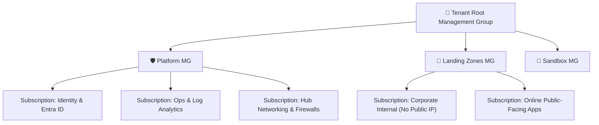

# 🌐 Architecture Blueprint: Enterprise Landing Zone & Zero-Trust Hub-Spoke Network

A production-grade reference architecture for implementing an **Azure Landing Zone (ALZ)** based on the **Microsoft Cloud Adoption Framework (CAF)** with a secure **Hub-and-Spoke** network topology.

---

## 📑 Table of Contents
1. [Overview & Management Group Hierarchy](#1-overview--management-group-hierarchy)
2. [Target Network Architecture Diagram](#2-target-network-architecture-diagram)
3. [Network Traffic Routing & Forced Tunneling](#3-network-traffic-routing--forced-tunneling)
4. [Centralized Private DNS Resolution Topology](#4-centralized-private-dns-resolution-topology)
5. [Azure Policy & Security Guardrails](#5-azure-policy--security-guardrails)
6. [Production Triage & Incident Runbook](#6-production-triage--incident-runbook)

---

## 1. Overview & Management Group Hierarchy

Enterprise scale demands multi-subscription governance to avoid resource limits and isolate blast radiuses:



---

## 2. Target Network Architecture Diagram

```mermaid
flowchart TD
    subgraph OnPrem["Enterprise On-Premises"]
        Datacenter[Corporate Datacenter / Branch Offices]
    end

    subgraph Hub_VNet["Connectivity Hub VNet (10.0.0.0/16)"]
        Gateway[ExpressRoute / VPN Gateway]
        Firewall[Azure Firewall Premium: TLS Inspection & IDPS]
        Bastion[Azure Bastion: Secure RDP/SSH]
        DNSResolver[Azure DNS Private Resolver]
    end

    Datacenter <==>|ExpressRoute Dedicated Private Circuit| Gateway
    Gateway --> Firewall

    subgraph Spoke_Data["Data Platform Spoke VNet (10.1.0.0/16)"]
        ADLS_PE["Private Endpoint: ADLS Gen2"]
        Databricks["Azure Databricks Managed VNet"]
        Synapse["Fabric / Synapse Managed VNet"]
    end

    subgraph Spoke_Apps["Application Spoke VNet (10.2.0.0/16)"]
        AKS["Azure Kubernetes Service (Azure CNI Overlay)"]
        AppSvc["App Service (Regional VNet Integration)"]
    end

    Firewall <-->|VNet Peering + UDR (0.0.0.0/0)| Spoke_Data
    Firewall <-->|VNet Peering + UDR (0.0.0.0/0)| Spoke_Apps
```

---

## 3. Network Traffic Routing & Forced Tunneling

To enforce Zero Trust and prevent data exfiltration, all outbound traffic from spoke subnets is forced through the central Azure Firewall using **User Defined Routes (UDR)**:

### Route Table Configuration (`rt-spoke-to-firewall`)
| Route Name | Address Prefix | Next Hop Type | Next Hop IP | Purpose |
| :--- | :--- | :--- | :--- | :--- |
| **DefaultOutbound** | `0.0.0.0/0` | Virtual Appliance | `10.0.1.4` (Azure Firewall) | Forces all internet and cross-spoke traffic through Firewall IDPS inspection |
| **IntraSubnet** | `10.1.0.0/16` | Virtual Network | None | Local subnet-to-subnet traffic routes within spoke without firewall latency |

---

## 4. Centralized Private DNS Resolution Topology

A common failure mode in Azure networking is fragmented DNS resolution for PaaS Private Endpoints:
- All **Private DNS Zones** (`privatelink.blob.core.windows.net`, `privatelink.database.windows.net`) are hosted in the **Connectivity Subscription**.
- The Private DNS Zones are linked directly to the **Hub VNet**.
- An **Azure DNS Private Resolver** in the Hub forwards DNS queries between on-premises Active Directory DNS and Azure Private DNS, ensuring seamless hybrid resolution.

---

## 5. Azure Policy & Security Guardrails

Deploy Azure Policies at the **Landing Zones Management Group** level to enforce non-negotiable security guardrails:
1. **Deny Public IP Addresses**: Blocks creation of public IP resources inside Corporate Landing Zone subscriptions.
2. **Require Tags**: Enforces mandatory `CostCenter`, `Environment`, and `Owner` tags on all resource groups.
3. **Enforce Storage Encryption**: Restricts storage creation unless infrastructure encryption (double encryption) and minimum TLS 1.2 are specified.
4. **Location Restriction**: Denies resource deployments outside approved corporate regions (e.g. `East US`, `West US 3`).

---

## 6. Production Triage & Incident Runbook

### Incident 1: Cross-Spoke Communication Timeout
- **Symptom**: AKS pods in Spoke A cannot reach an API or database in Spoke B; connection times out.
- **Root Cause**: Spoke-to-spoke VNet peering is non-transitive by default. Traffic must route through the Hub Firewall, but either:
  1. The Spoke route table does not direct `10.2.0.0/16` or `0.0.0.0/0` to the Firewall virtual appliance IP.
  2. The Azure Firewall network rules are missing an allow rule between `10.1.0.0/16` and `10.2.0.0/16`.
- **Remediation**:
  1. Verify the effective route table on the VM/subnet via CLI:
     ```bash
     az network nic show-effective-route-table -g rg-apps -n nic-worker-01 -o table
     ```
  2. Add an Azure Firewall Network Rule allowing the required TCP ports between Spoke CIDRs.

### Incident 2: Private Endpoint Resolving to Public IP
- **Symptom**: Applications attempting to connect to Azure Storage or SQL receive connection refused or attempt to route over the public internet.
- **Root Cause**: The Spoke VNet's custom DNS settings do not route queries to Azure provided DNS (`168.63.129.16`) or the central Azure DNS Private Resolver.
- **Remediation**:
  1. Set Spoke VNet DNS to point to the Hub Azure DNS Private Resolver IP.
  2. Confirm that the corresponding Private DNS Zone has an active virtual network link to the Hub VNet.

---

[← Back to Main Cheat Sheet](../README.md)
