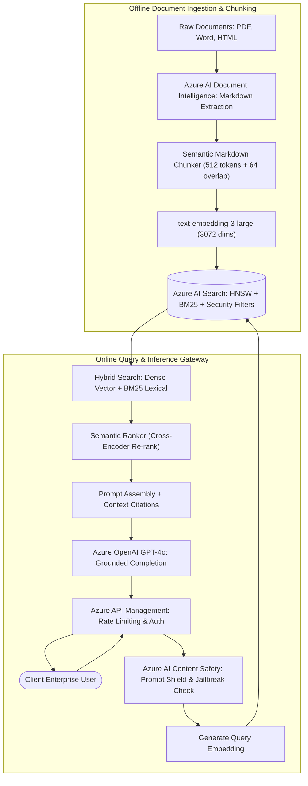
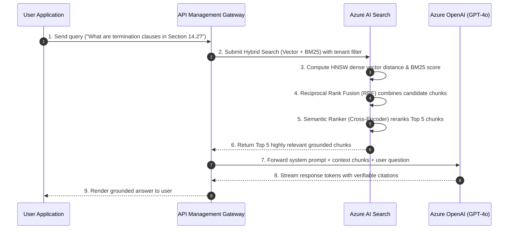

# 🤖 Architecture Blueprint: Enterprise GenAI & Hybrid RAG Platform

A production-tested reference architecture for enterprise **Retrieval-Augmented Generation (RAG)** leveraging **Azure OpenAI Service**, **Azure AI Search (Hybrid + Semantic Ranker)**, **Azure AI Document Intelligence**, and **API Management**.

---

## 📑 Table of Contents
1. [Architecture Overview & Enterprise Requirements](#1-architecture-overview--enterprise-requirements)
2. [Target Architecture Diagram](#2-target-architecture-diagram)
3. [Document Ingestion & Indexing Pipeline](#3-document-ingestion--indexing-pipeline)
4. [Hybrid Query Execution & Reranking Flow](#4-hybrid-query-execution--reranking-flow)
5. [Enterprise Security, Guardrails & FinOps](#5-enterprise-security-guardrails--finops)
6. [Production Triage & Incident Runbook](#6-production-triage--incident-runbook)

---

## 1. Architecture Overview & Enterprise Requirements

Enterprise generative AI solutions must satisfy four non-negotiable requirements:
1. **Zero Hallucination / Strict Grounding**: Models must cite exact internal document sources and page numbers.
2. **Sub-Second Latency**: Query embedding, hybrid retrieval, reranking, and initial token streaming under 1.5 seconds.
3. **Multi-Tenant Security & ACL Trimming**: Users must only retrieve information they have verified Entra ID security permissions to view.
4. **Resilience & Rate Limit Protection**: Defend against Azure OpenAI `HTTP 429 (Too Many Requests)` using gateway-level token buckets and multi-region failover.

---

## 2. Target Architecture Diagram



---

## 3. Document Ingestion & Indexing Pipeline

### Layout-Aware Semantic Extraction
Standard naive text extraction strips table borders and collapses multi-column text into gibberish. We use **Azure AI Document Intelligence** with Markdown output:

```python
from azure.ai.documentintelligence import DocumentIntelligenceClient
from azure.core.credentials import AzureKeyCredential

client = DocumentIntelligenceClient(endpoint=AZURE_ENDPOINT, credential=AzureKeyCredential(AZURE_KEY))

with open("annual_report.pdf", "rb") as f:
    poller = client.begin_analyze_document("prebuilt-layout", analyze_request=f, output_content_format="markdown")
    result = poller.result()
    markdown_content = result.content
```

### Integrated Chunking & Vectorization
- **Chunk Size**: 512 tokens with 64-token overlap, aligned to markdown headings (`#`, `##`).
- **Embedding Model**: `text-embedding-3-large` (3072 dimensions) with cosine similarity metric.
- **Index Payload**: Stores chunk text, document URI, page number, and Entra ID security ACL array (`tenant_id`, `department_acl`).

---

## 4. Hybrid Query Execution & Reranking Flow

Pure vector search struggles on exact product serial numbers, legal codes, and acronyms; pure keyword search fails on semantic intent. **Hybrid Retrieval + Semantic Ranker** delivers state-of-the-art accuracy:



---

## 5. Enterprise Security, Guardrails & FinOps

### 1. Zero Trust Ingress & Private Link
- Azure OpenAI and Azure AI Search public endpoints are **disabled**.
- Traffic travels strictly over Azure Private Endpoints inside dedicated spoke subnets.

### 2. Guardrails with Azure AI Content Safety
- **Prompt Shield**: Detects adversarial jailbreaks and indirect prompt injection attempts.
- **PII Redaction**: Strips Social Security Numbers, Credit Card numbers, and passwords prior to model submission.

### 3. API Management Throttling & Failover
- Token bucket rate limiting per subscription key prevents a single department from exhausting tenant quotas.
- Automatic circuit-breaker failover switches between primary region (`East US`) and secondary region (`North Central US`) when `HTTP 429` is detected.

---

## 6. Production Triage & Incident Runbook

### Incident 1: HTTP 429 Token Limit Exceeded (Rate Throttling)
- **Symptom**: Application experiences intermittent request drops and `RateLimitExceeded` error codes.
- **Root Cause**: Batch jobs or sudden user traffic spikes exceeded Provisioned Throughput Units (PTU) or TPM limits.
- **Remediation**:
  1. Route traffic through **Azure API Management** with round-robin load balancing across two Azure OpenAI regions.
  2. Implement exponential backoff with jitter on client applications using the official Azure SDK.
  3. Deploy Provisioned Throughput Units (PTU) for guaranteed latency and throughput SLAs.

### Incident 2: Retrieval Irrelevance / Model Hallucinations
- **Symptom**: LLM produces generalized responses without referencing internal enterprise documents.
- **Root Cause**: Low retrieval recall; relevant chunks were scored below threshold during vector search.
- **Remediation**:
  1. Verify **Semantic Ranker** is active in the AI Search query payload.
  2. Inspect chunk sizes: Reduce chunk size from 1500 tokens to 512 tokens to improve embedding granularity.
  3. Incorporate metadata field boosting (e.g. giving higher weight to `title` and `keywords` fields).

---

[← Back to Main Cheat Sheet](../README.md)
