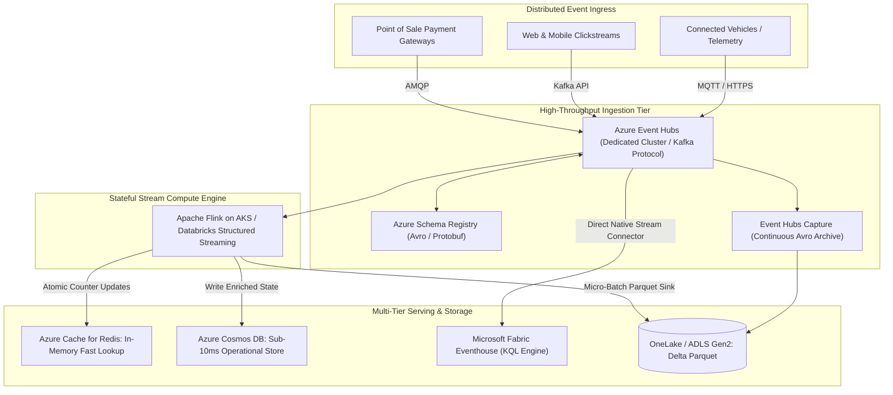

# ⚡ Architecture Blueprint: High-Throughput Real-Time Streaming & IoT Platform

A production-proven reference architecture for ingesting, processing, and analyzing **millions of events per second** using **Azure Event Hubs**, **Apache Flink / Databricks Structured Streaming**, **Azure Cosmos DB**, and **Microsoft Fabric Real-Time Intelligence**.

---

## 📑 Table of Contents
1. [Platform Overview & SLAs](#1-platform-overview--slas)
2. [Target Architecture Diagram](#2-target-architecture-diagram)
3. [Stream Processing & Windowing Mechanics](#3-stream-processing--windowing-mechanics)
4. [Storage & Multi-Speed Serving (Hot vs. Warm vs. Cold)](#4-storage--multi-speed-serving-hot-vs-warm-vs-cold)
5. [Production Triage & Incident Runbook](#5-production-triage--incident-runbook)

---

## 1. Platform Overview & SLAs

Designed for global connected vehicle fleets, e-commerce clickstream analytics, and financial payment fraud monitoring:
- **Ingestion Scale**: 100,000 to 2,000,000 events/second sustained.
- **End-to-End Latency**: $<200\text{ms}$ to hot operational serving; $<60\text{s}$ to analytical Lakehouse.
- **Resilience**: Zero message loss guaranteed via **Schema Registry**, partition replication, and Dead Letter Queues (DLQ).

---

## 2. Target Architecture Diagram



---

## 3. Stream Processing & Windowing Mechanics

### Event-Time Watermarking & Sliding Windows
To prevent out-of-order sensor packets from corrupting state calculations, the streaming engine applies **bounded out-of-orderness watermarks**:

```python
# Databricks Structured Streaming with 10-minute watermark and sliding window
streaming_df = (
    spark.readStream
    .format("kafka")
    .option("kafka.bootstrap.servers", "eh-prod.servicebus.windows.net:9093")
    .option("subscribe", "vehicle-telemetry")
    .load()
    .selectExpr("CAST(value AS STRING) as json_payload", "timestamp")
    .select(from_json("json_payload", telemetry_schema).alias("data"), "timestamp")
    .withWatermark("timestamp", "10 minutes")
    .groupBy(
        window("timestamp", "5 minutes", "1 minute"),
        "data.vehicle_id"
    )
    .agg(
        avg("data.speed_kmh").alias("avg_speed"),
        max("data.engine_temp").alias("max_temp")
    )
)
```

---

## 4. Storage & Multi-Speed Serving (Hot vs. Warm vs. Cold)

| Serving Layer | Technology | Query Latency | Primary Consumers |
| :--- | :--- | :--- | :--- |
| **Hot Path** | Azure Cache for Redis & Azure Cosmos DB | **$<10\text{ms}$** | Real-time fraud detection APIs, driver mobile apps |
| **Warm Path** | Microsoft Fabric Eventhouse (Kusto / KQL) | **$<1\text{s}$** | Ops NOC real-time dashboards, anomaly exploration, APM |
| **Cold Path** | OneLake Delta Lake / ADLS Gen2 | Minutes | Machine learning model training, historical BI trend analysis |

---

## 5. Production Triage & Incident Runbook

### Incident 1: Consumer Lag Explosion in Event Hubs
- **Symptom**: Event processing latency escalates; consumer lag metric (`IncomingBytes - OutgoingBytes`) climbs steadily.
- **Root Cause**: Downstream write sink (e.g. database connection exhaustion or network throttling) is blocking stream workers.
- **Remediation**:
  1. Inspect worker thread dumps to confirm if external I/O is synchronous. Convert all external calls to **Async I/O**.
  2. Scale consumer task slots up to match the number of Event Hub partitions.
  3. Increase Event Hubs Throughput Units (TUs) or Processing Units (PUs) if ingestion throttling is detected.

### Incident 2: Cosmos DB Hot Partition Throttling (`HTTP 429`)
- **Symptom**: Write operations from the streaming job fail with `RequestRateTooLarge` errors.
- **Root Cause**: Partition key skew (e.g. all fleet events written with a static partition key like `date`).
- **Remediation**:
  1. Refactor the partition key to a synthetic composite key: `${vehicle_id}_${event_hour}`.
  2. Enable Cosmos DB Autoscale throughput to automatically burst up to $10\times$ baseline RU/s during sudden traffic surges.

### Incident 3: Schema Poison Pill in Stream
- **Symptom**: Streaming job crashes with deserialization error when reading corrupt JSON/binary payload.
- **Remediation**:
  1. Enforce validation via **Azure Schema Registry**.
  2. Wrap payload parser in a `try...catch` block, routing unparseable payloads immediately to a dedicated **Dead Letter Queue (DLQ)** container in Blob storage for offline inspection.

---

[← Back to Main Cheat Sheet](../README.md)
