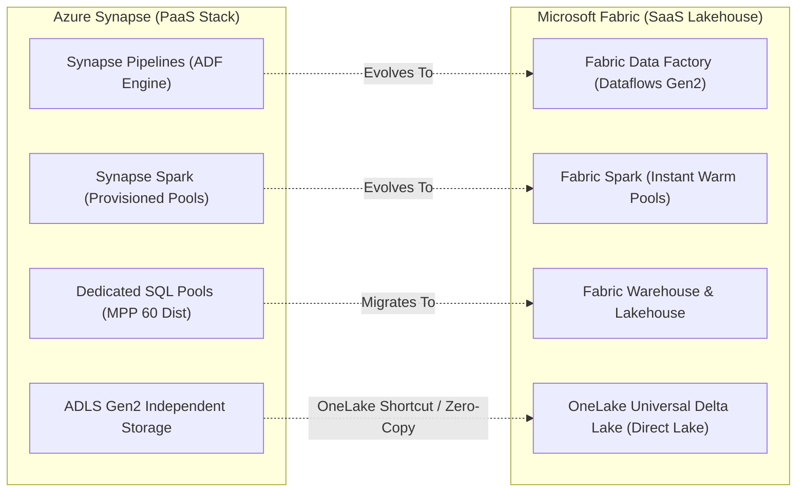

# 🔄 Azure Service Evolution, Renaming & Migration Reference

A definitive index of Microsoft Azure service rebrands, product mergers, deprecations, and retirement migration paths. Critical for enterprise architects, certification candidates (AZ-104, AZ-305, AZ-204, DP-203, DP-600, AI-102), and DevOps engineers maintaining infrastructure code.

---

## 📑 Table of Contents
1. [Master Evolution & Renaming Matrix](#1-master-evolution--renaming-matrix)
2. [Retired Services & Migration Runbooks](#2-retired-services--migration-runbooks)
3. [The Big Three Architectural Transitions](#3-the-big-three-architectural-transitions)
   - [Azure AD ➔ Microsoft Entra ID](#azure-ad--microsoft-entra-id)
   - [Azure Cognitive Search ➔ Azure AI Search](#azure-cognitive-search--azure-ai-search)
   - [Azure Synapse ➔ Microsoft Fabric](#azure-synapse--microsoft-fabric)

---

## 1. Master Evolution & Renaming Matrix

| Former Product Name | Modern / Current Name | Category | Status | Primary Reason & Upgrades |
| :--- | :--- | :--- | :--- | :--- |
| **Azure Active Directory (Azure AD)** | **Microsoft Entra ID** | Security & Identity | **Active** | Rebranded under Microsoft Entra suite. Adds Workload Identities, Privileged Identity Management (PIM), Entra Verified ID, and Zero Trust Network Access (ZTNA). |
| **Azure Cognitive Search** | **Azure AI Search** | AI & Search | **Active** | Rebranded to reflect vector search, hybrid retrieval (BM25 + Dense Vectors), Semantic Ranker, and integrated embedding pipelines for GenAI/RAG. |
| **Azure Cognitive Services** | **Azure AI Services / Azure AI Foundry** | Artificial Intelligence | **Active** | Unified multi-service API keys, Azure OpenAI Service integration, and unified developer tooling via Azure AI Foundry. |
| **Azure Security Center + Azure Defender** | **Microsoft Defender for Cloud** | Security | **Active** | Unified Cloud Security Posture Management (CSPM) and Cloud Workload Protection Platform (CWPP) across Azure, AWS, and GCP. |
| **Azure Sentinel** | **Microsoft Sentinel** | Security / SIEM | **Active** | Rebranded to Microsoft Sentinel with multi-cloud and Microsoft 365 XDR unified copilot integrations. |
| **Azure Purview** | **Microsoft Purview** | Governance & Compliance | **Active** | Expanded beyond data catalog to unify data governance, compliance, sensitivity labels, DLP, and insider risk across cloud ecosystems. |
| **Azure Spring Cloud** | **Azure Spring Apps** | Compute / Java | **Active** | Joint enterprise collaboration with VMware/Broadcom with Standard and Enterprise tiers supporting Spring Boot. |
| **Azure Analysis Services (AAS)** | **Power BI Premium / Fabric Semantic Models** | Analytics / BI | **Deprecated** | Modern workloads transitioned to Power BI / Fabric Direct Lake semantic models with VertiPaq engine and XMLA endpoints. |
| **Time Series Insights (TSI)** | **Azure Data Explorer (ADX) / Fabric Real-Time Intelligence** | IoT / Streaming | **Retired** | TSI was deprecated on March 31, 2025. Workloads migrate to ADX (Kusto) or Fabric Eventhouse. |
| **Azure Data Lake Storage Gen1 (ADLS Gen1)** | **Azure Data Lake Storage Gen2 (ADLS Gen2)** | Storage | **Retired** | ADLS Gen1 was fully retired on February 29, 2024. Gen2 integrates Hierarchical Namespace (HNS) directly on Azure Blob Storage. |
| **Cloud Services (classic)** | **Azure App Service / AKS / VMSS (Flexible)** | Compute | **Retired** | Azure Cloud Services (classic) based on ASM retired on August 31, 2024. Migrated to ARM-native compute. |
| **PostgreSQL / MySQL Single Server** | **Azure Database for PostgreSQL / MySQL Flexible Server** | Databases | **Retired** | Single Server retired in late 2024 / early 2025. Flexible Server provides zone-redundant HA, custom maintenance windows, and `pgvector`. |
| **Azure Media Services** | **Partner Solutions (Ravnur, MediaKind, Bitmovin)** | Media / Streaming | **Retired** | Retired June 30, 2024. Transcoding and streaming workloads transitioned to certified partner solutions. |
| **StorSimple** | **Azure File Sync / Azure NetApp Files** | Storage / Hybrid | **Retired** | Appliance-based hybrid storage replaced by cloud-native Azure File Sync and Azure NetApp Files (ANF). |
| **Virtual Machines (classic - ASM)** | **Virtual Machines (Azure Resource Manager - ARM)** | Compute | **Retired** | Azure Service Manager (ASM) stack completely decommissioned. All VMs now run under ARM. |

---

## 2. Retired Services & Migration Runbooks

### 1. Migrating ADLS Gen1 ➔ ADLS Gen2
- **Key Challenge**: ADLS Gen1 used `adl://` endpoints and proprietary POSIX ACLs.
- **Migration Path**:
  1. Provision an **ADLS Gen2** Storage Account with `--enable-hierarchical-namespace true`.
  2. Use **Azure Data Factory** or **AzCopy** to replicate datasets while preserving ACL permissions.
  3. Update connection strings in Spark / Databricks notebooks from `adl://` to `abfss://<container>@<account>.dfs.core.windows.net/`.

### 2. Migrating PostgreSQL Single Server ➔ Flexible Server
- **Key Challenge**: Storage architecture and extensions differ. Single Server lacked fine-grained vCore compute scaling.
- **Migration Path**:
  1. Utilize the **Azure Database Migration Service (DMS)** or the built-in Flexible Server Migration Tool.
  2. Perform online sync to achieve near-zero downtime cutover.
  3. Enable `pgvector` extension for generative AI vector indexing:
     ```sql
     CREATE EXTENSION IF NOT EXISTS vector;
     ```

### 3. Migrating Time Series Insights (TSI) ➔ Azure Data Explorer (ADX)
- **Key Challenge**: TSI queries used custom JSON expressions; ADX uses **Kusto Query Language (KQL)**.
- **Migration Path**:
  1. Create an Azure Data Explorer cluster or Microsoft Fabric Eventhouse.
  2. Configure native ingestion connections to Azure Event Hubs or IoT Hub.
  3. Recreate TSI timeseries visualizations in Azure Data Explorer Dashboards or Power BI.

---

## 3. The Big Three Architectural Transitions

### Azure AD ➔ Microsoft Entra ID
The rename from Azure Active Directory to Microsoft Entra ID (effective late 2023) reflects the shift toward unified Zero Trust identity across clouds, SaaS, and on-premises infrastructure.

```
Azure Active Directory (Legacy)             Microsoft Entra ID (Modern)
───────────────────────────────             ───────────────────────────
Azure AD Free / Premium P1/P2        ───►   Microsoft Entra ID P1 / P2
Azure AD App Registrations           ───►   Microsoft Entra App Registrations
Azure AD Managed Identities          ───►   Managed Identities for Azure Resources
Azure AD Privileged Identity Mgmt    ───►   Microsoft Entra PIM
Azure AD B2C                         ───►   Microsoft Entra External ID
```

> [!NOTE]
> All authentication endpoints (`login.microsoftonline.com`), client IDs, tenant IDs, Microsoft Authentication Library (MSAL) SDKs, and Graph API endpoints (`graph.microsoft.com`) remain 100% backwards-compatible.

---

### Azure Cognitive Search ➔ Azure AI Search
Azure Cognitive Search was renamed to **Azure AI Search** to solidify its role as the industry benchmark vector and retrieval-augmented generation (RAG) engine.

```
Legacy Capability                        Modern AI Search Feature
─────────────────                        ────────────────────────
Keyword Full-Text Search (BM25)    ───►  Hybrid Search (BM25 + Dense Vectors)
Standard Scoring Profiles          ───►  Semantic Ranker (Deep Learning Cross-Encoder)
Manual Chunking & Indexing         ───►  Integrated Vectorization Pipeline
Text-Only Indexing                 ───►  Multi-Modal Embeddings & Image Vector Search
```

---

### Azure Synapse ➔ Microsoft Fabric
While Azure Synapse Analytics remains fully supported, Microsoft's innovation is focused on **Microsoft Fabric**:



---

[← Back to Main Cheat Sheet](../README.md)
