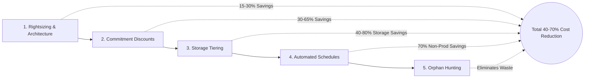

# 💰 Azure FinOps & Cost Optimization Runbook

A production-grade guide to reducing cloud waste, rightsizing infrastructure, and automating cost governance across Microsoft Azure.

---

## 📑 Table of Contents
1. [The 5 Pillars of Azure Cost Optimization](#1-the-5-pillars-of-azure-cost-optimization)
2. [Pricing Models: Pay-As-You-Go vs. Savings Plans vs. Reservations](#2-pricing-models-pay-as-you-go-vs-savings-plans-vs-reservations)
3. [Spot Instance Strategy & Eviction Handling](#3-spot-instance-strategy--eviction-handling)
4. [Storage FinOps: Tiering, Compaction & Lifecycle Policies](#4-storage-finops-tiering-compaction--lifecycle-policies)
5. [Automated Capacity Scheduling (Fabric, Synapse & VMs)](#5-automated-capacity-scheduling-fabric-synapse--vms)
6. [Triage Scripts: Detecting Orphaned Cloud Resources](#6-triage-scripts-detecting-orphaned-cloud-resources)
7. [Budgets & Cost Alerts Setup via CLI](#7-budgets--cost-alerts-setup-via-cli)

---

## 1. The 5 Pillars of Azure Cost Optimization



---

## 2. Pricing Models: Pay-As-You-Go vs. Savings Plans vs. Reservations

| Commitment Model | Discount Range | Flexibility | Scope | Ideal Workloads |
| :--- | :--- | :--- | :--- | :--- |
| **Pay-As-You-Go (PAYG)** | 0% (Base price) | Maximum (Cancel/change anytime) | Per second / hour | Short-term spikes, unproven prototypes, dynamic seasonal bursts |
| **Azure Savings Plan for Compute** | Up to **65%** | **High** (Applies across VM families, Container Apps, App Service, Functions) | Hourly \$ commitment (1 or 3 yrs) | Dynamic workloads where VM series or compute types frequently evolve |
| **Reserved Instances (RI)** | Up to **72%** | **Rigid** (Tied to specific VM series and region, exchangeable with limits) | Specific SKU & Region (1 or 3 yrs) | Steady-state production database nodes, enterprise Kafka clusters, primary domain controllers |

> [!TIP]
> **FinOps Strategy**: Layer your commitments! Cover 60-70% of base capacity with Reserved Instances; cover the next 15-20% with Azure Savings Plans; absorb unpredictable spikes with Pay-As-You-Go or Spot instances.

---

## 3. Spot Instance Strategy & Eviction Handling

Spot VMs offer up to **90% discount** compared to PAYG by utilizing idle Azure datacenter capacity. However, Azure can evict them with a **30-second notice**.

### Handling Spot Eviction via Scheduled Events API
Inside an Azure VM or container, query the metadata service continuously:

```bash
# Query Azure Instance Metadata Service (IMDS) for scheduled eviction notice
curl -s -H Metadata:true "http://169.254.169.254/metadata/scheduledevents?api-version=2020-09-01" | jq .
```

When an event with `EventType: "Preempt"` is detected:
1. Signal the orchestrator (e.g. Kubernetes cordons node).
2. Drain in-flight jobs and flush transaction write-ahead logs to remote storage.
3. Terminate gracefully before physical VM deallocation.

---

## 4. Storage FinOps: Tiering, Compaction & Lifecycle Policies

### Azure Storage Blob Tier Economics

| Storage Tier | Storage Cost / GB / Month | Read Cost / 10k Operations | Minimum Retention | Best For |
| :--- | :--- | :--- | :--- | :--- |
| **Hot** | $\approx \$0.018$ | $\approx \$0.004$ | None | Active data, current month analytics, raw ingestion |
| **Cool** | $\approx \$0.010$ (45% cheaper) | $\approx \$0.010$ | 30 days | Data accessed $<1$ time per month, monthly backups |
| **Cold** | $\approx \$0.0036$ (80% cheaper) | $\approx \$0.025$ | 90 days | Historical logs, quarterly compliance archives |
| **Archive** | $\approx \$0.00099$ (95% cheaper) | High rehydration fee | 180 days | Multi-year regulatory archives (SOX, HIPAA, GDPR) |

### Automated Terraform Lifecycle Management Policy
Save 60%+ automatically by archiving telemetry files after 90 days:

```hcl
resource "azurerm_storage_management_policy" "lakehouse_tiering" {
  storage_account_id = azurerm_storage_account.lake.id

  rule {
    name    = "auto_tier_telemetry_historical"
    enabled = true
    filters {
      prefix_match = ["raw/telemetry/year="]
      blob_types   = ["blockBlob"]
    }
    actions {
      base_blob {
        tier_to_cool_after_days_since_modification_greater_than    = 30
        tier_to_archive_after_days_since_modification_greater_than = 90
        delete_after_days_since_modification_greater_than          = 730
      }
    }
  }
}
```

---

## 5. Automated Capacity Scheduling (Fabric, Synapse & VMs)

Running development and testing infrastructure 24/7 wastes **70% of compute budget** over weekends and non-business hours (128 idle hours out of 168 hours per week).

### Fabric F-SKU & Synapse Pause/Resume Script
Schedule via Azure Automation, Logic Apps, or GitHub Actions:

```bash
#!/usr/bin/env bash
# auto-suspend-dev.sh: Shuts down non-prod capacity at 19:00 UTC

# 1. Suspend Microsoft Fabric Capacity
az fabric capacity suspend \
  --resource-group rg-fabric-dev \
  --capacity-name capfabricdev01

# 2. Pause Azure Synapse Dedicated SQL Pool
az synapse sql pool pause \
  --workspace-name syn-workspace-dev \
  --name DedicatedPoolDev \
  --resource-group rg-synapse-dev

# 3. Deallocate Development VMs (Deallocated = $0 compute charges)
az vm deallocate \
  --ids $(az vm list -g rg-dev-eastus --query "[].id" -o tsv)
```

---

## 6. Triage Scripts: Detecting Orphaned Cloud Resources

### 1. Identify Unattached Managed Disks
When VMs are deleted, their virtual OS and data disks often remain behind in "Unattached" state, silently billing monthly storage fees:

```bash
az disk list \
  --query "[?managedBy==null].{ResourceGroup:resourceGroup, DiskName:name, SizeGB:diskSizeGb, CostPerMonthEstimate:sku.name}" \
  --output table
```

### 2. Identify Idle / Orphaned Public IPs
Unassociated Public IP addresses incur hourly reservation fees:

```bash
az network public-ip list \
  --query "[?ipConfiguration==null].{ResourceGroup:resourceGroup, IPName:name, Address:ipAddress}" \
  --output table
```

### 3. Identify Outdated VM Snapshots Older Than 90 Days
```bash
az snapshot list \
  --query "[?timeCreated<='$(date -v-90d +%Y-%m-%d)'].{Name:name, RG:resourceGroup, Created:timeCreated, SizeGB:diskSizeGb}" \
  --output table
```

---

## 7. Budgets & Cost Alerts Setup via CLI

Enforce hard governance guardrails before receiving surprise monthly bills:

```bash
# Create a monthly spending budget with 80% and 100% threshold alert emails
az consumption budget create \
  --budget-name "Monthly-Analytics-Budget" \
  --amount 5000 \
  --category "Cost" \
  --time-grain "Monthly" \
  --start-date "$(date +%Y-%m-01)" \
  --end-date "2030-12-31" \
  --notifications '{
    "AlertAt80Percent": {
      "enabled": true,
      "operator": "GreaterThan",
      "threshold": 80,
      "contactEmails": ["finops-alerts@company.com"]
    },
    "AlertAt100Percent": {
      "enabled": true,
      "operator": "GreaterThan",
      "threshold": 100,
      "contactEmails": ["lead-architect@company.com"]
    }
  }'
```

---

[← Back to Main Cheat Sheet](../README.md)
