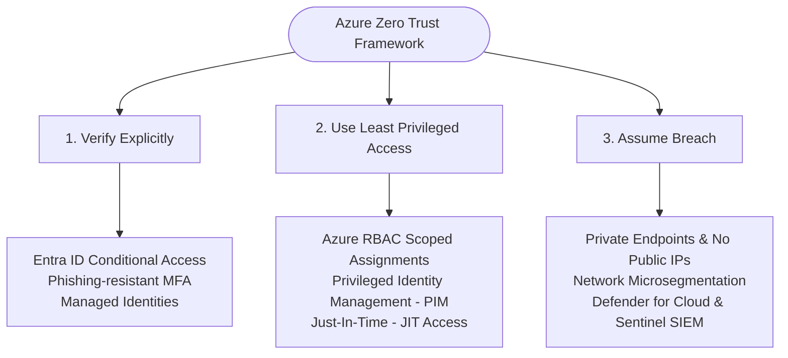
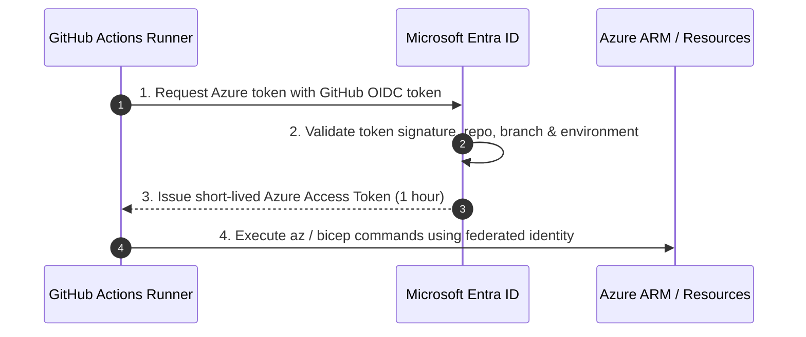
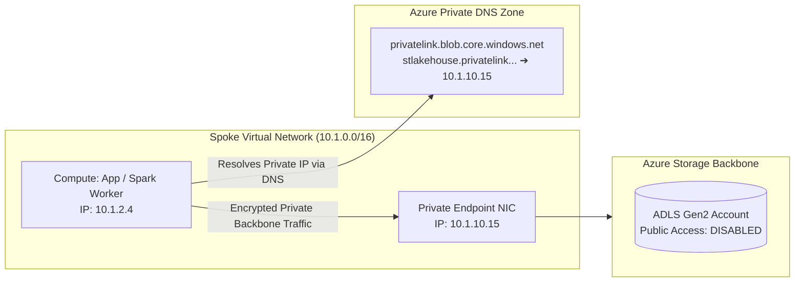

# 🛡️ Azure Zero Trust Security & Identity Cheat Sheet

A comprehensive enterprise reference for implementing **Zero Trust Architecture**, **Microsoft Entra ID**, **Private Link networking**, and **Microsoft Defender for Cloud** on Azure.

---

## 📑 Table of Contents
1. [The 3 Core Principles of Zero Trust on Azure](#1-the-3-core-principles-of-zero-trust-on-azure)
2. [Microsoft Entra ID & Modern Identity](#2-microsoft-entra-id--modern-identity)
3. [Workload Identity Federation with GitHub Actions (OIDC)](#3-workload-identity-federation-with-github-actions-oidc)
4. [Azure Key Vault: Modern RBAC Authorization](#4-azure-key-vault-modern-rbac-authorization)
5. [Private Endpoints & Azure Private Link Topology](#5-private-endpoints--azure-private-link-topology)
6. [Network Defense: NSGs, ASGs & Azure Firewall Premium](#6-network-defense-nsgs-asgs--azure-firewall-premium)
7. [Microsoft Defender for Cloud & Security Posture (CSPM)](#7-microsoft-defender-for-cloud--security-posture-cspm)

---

## 1. The 3 Core Principles of Zero Trust on Azure



---

## 2. Microsoft Entra ID & Modern Identity

### System-Assigned vs. User-Assigned Managed Identity

| Feature | System-Assigned Identity | User-Assigned Identity |
| :--- | :--- | :--- |
| **Lifecycle** | Tied directly to the parent resource. Deleted when resource is deleted. | Independent lifecycle. Created and managed as a standalone Azure resource. |
| **Sharing** | Cannot be shared across multiple resources. | Can be assigned to multiple VMs, Container Apps, or Functions. |
| **Best Used For** | Single, isolated workloads (e.g. one specific Function app needing Key Vault access). | Distributed microservices, pool of batch workers, or CI/CD runner pools sharing identical permissions. |

---

## 3. Workload Identity Federation with GitHub Actions (OIDC)

Eliminate long-lived client secrets in GitHub repositories! GitHub Actions exchanges an OpenID Connect (OIDC) JWT token for a short-lived (1-hour) Azure access token:



### GitHub Actions Workflow Implementation
```yaml
name: Deploy Infrastructure to Azure via OIDC

on:
  push:
    branches: [ main ]

permissions:
  id-token: write # Required for requesting OIDC token
  contents: read

jobs:
  deploy:
    runs-on: ubuntu-latest
    steps:
      - name: Checkout Code
        uses: actions/checkout@v4

      - name: Log in to Azure via OIDC
        uses: azure/login@v2
        with:
          client-id: ${{ secrets.AZURE_CLIENT_ID }}
          tenant-id: ${{ secrets.AZURE_TENANT_ID }}
          subscription-id: ${{ secrets.AZURE_SUBSCRIPTION_ID }}

      - name: Run Azure CLI Commands
        run: |
          az account show
          az bicep build --file main.bicep
```

---

## 4. Azure Key Vault: Modern RBAC Authorization

Legacy Azure Key Vault Access Policies applied broad, coarse-grained permissions. **Azure RBAC Key Vault authorization** provides unified, granular access control:

### Built-in Key Vault RBAC Roles
- **Key Vault Administrator**: Full management of vault, keys, secrets, and certificates.
- **Key Vault Secrets Officer**: Create, update, and delete secrets (no permission to read secret payloads).
- **Key Vault Secrets User**: Read secret contents (ideal for application workloads and managed identities).
- **Key Vault Crypto User**: Perform cryptographic operations (sign, verify, encrypt, decrypt) without exposing private keys.

```bash
# Assign Key Vault Secrets User to a workload Managed Identity
az role assignment create \
  --assignee-object-id "$WORKLOAD_PRINCIPAL_ID" \
  --assignee-principal-type ServicePrincipal \
  --role "Key Vault Secrets User" \
  --scope "/subscriptions/$SUB_ID/resourceGroups/rg-sec-prod/providers/Microsoft.KeyVault/vaults/kv-core-prod01"
```

> [!IMPORTANT]
> **Ransomware Protection**: Always enable **Soft Delete** (90-day retention) and **Purge Protection**. Purge protection guarantees that secrets cannot be permanently deleted until the retention window expires, even by a Global Administrator!

---

## 5. Private Endpoints & Azure Private Link Topology

Private Endpoints assign a private IP address from your Virtual Network subnet to Azure PaaS services (ADLS Gen2, SQL Database, Cosmos DB, Key Vault, Azure OpenAI), completely disabling public internet exposure.



---

## 6. Network Defense: NSGs, ASGs & Azure Firewall Premium

- **Network Security Groups (NSGs)**: Stateful Layer 4 packet filtering (IP, port, protocol) attached to Subnets or Network Interfaces.
- **Application Security Groups (ASGs)**: Logical groupings of VMs (e.g. `asg-web-frontend`, `asg-api-backend`, `asg-db-cluster`), allowing clean NSG rules without managing individual IP addresses.
- **Azure Firewall Premium**: Cloud-native stateful Layer 7 firewall with:
  - **IDPS (Intrusion Detection & Prevention System)**: Deep packet inspection against known vulnerability signatures.
  - **TLS Inspection**: Decrypts outbound HTTPS traffic to detect malware payloads and command-and-control exfiltration.
  - **URL / FQDN Filtering**: Restricts outbound egress strictly to approved destinations (e.g. `*.github.com`, `repo.maven.apache.org`).

---

## 7. Microsoft Defender for Cloud & Security Posture (CSPM)

Microsoft Defender for Cloud continuously benchmarks subscriptions against regulatory frameworks:
- **CIS Microsoft Azure Foundations Benchmark**
- **NIST SP 800-53 Rev. 5**
- **PCI-DSS v4.0**
- **ISO/IEC 27001**

### Critical Security Baseline Checklist
- [x] All Storage Accounts enforce `allowBlobPublicAccess = false` and `supportsHttpsTrafficOnly = true`.
- [x] All PaaS databases (Azure SQL, Cosmos DB, PostgreSQL) have public network access set to `Disabled` with Private Link enabled.
- [x] Identity accounts enforce Phishing-resistant MFA with no permanent Global Administrator assignments (use Entra PIM).
- [x] Key Vaults have Soft Delete and Purge Protection enabled.
- [x] Diagnostic settings stream all Audit and Activity logs to an immutable Log Analytics workspace with 365-day retention.

---

[← Back to Main Cheat Sheet](../README.md)
