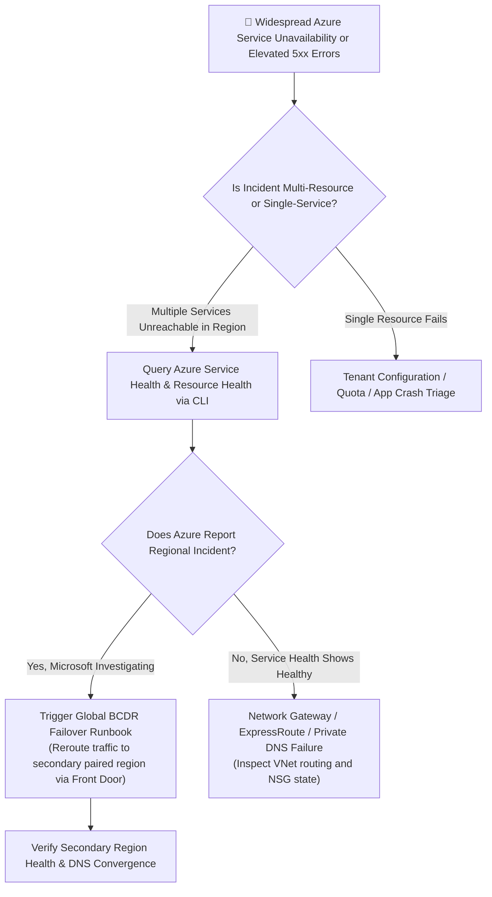

# 🚨 Runbook 01: Azure Regional Service Outage & Resource Health Triage

> **Incident Severity**: `SEV-1 (CRITICAL PRODUCTION OUTAGE)`  
> **Target Systems**: Azure Resource Health, Azure Service Health, Azure Front Door, Traffic Manager, Regional PaaS/IaaS  
> **Objective**: Detect regional cloud platform outages, distinguish tenant-isolated faults from widespread Azure infrastructure incidents, and execute global traffic rerouting.

---

## 1. Emergency Decision Tree



---

## 2. Immediate Diagnostic Procedures (First 5 Minutes)

### Step 1: Query Azure Service Health via CLI
Never rely exclusively on the Azure Portal during a major outage, as portal frontend authentication may be degraded. Query via Azure CLI:
```bash
# Check platform incidents across subscription
az rest --method get \
  --url "https://management.azure.com/subscriptions/{subscriptionId}/providers/Microsoft.ResourceHealth/events?api-version=2022-10-01" \
  --query "value[?properties.status=='Active'].{Title:properties.title, Region:properties.impact[0].impactedRegions[0], Status:properties.status}" \
  -o table
```

### Step 2: Query Targeted Resource Health
Check the real-time operational state of your critical database or compute resource:
```bash
# Check specific resource availability status
az resource-health status show \
  --resource-group rg-production-eastus \
  --resource-name sql-finance-prod \
  --resource-type Microsoft.Sql/servers/databases \
  -o json
```

---

## 3. Root Cause Analysis & Detailed Remediation

### Cause A: Confirmed Regional Cloud Outage (Power / Fiber / Cooling Failure)
- **Root Cause**: Microsoft data center loss in the primary paired region (e.g. East US).
- **Remediation & Recovery Strategy**:
  1. **Activate Global Traffic Rerouting via Azure Front Door**:
     Reroute backend endpoint traffic weighting to the secondary region (e.g. West US):
     ```bash
     # Set Front Door weighting to 0 for degraded region
     az afd endpoint update \
       --resource-group rg-global-networking \
       --profile-name afd-production \
       --endpoint-name ep-main-app \
       --enabled-state Enabled
     ```
  2. **Promote Secondary Read Replica / Storage**:
     For Azure SQL or Cosmos DB, initiate forced failover to the replica:
     ```bash
     az sql db replica set-secondary \
       --resource-group rg-production-westus \
       --server sql-westus-prod \
       --name db-finance \
       --partner-server sql-eastus-prod \
       --failover-type Forced
     ```

---

## 4. Verification & Prevention Checklist

- [ ] Global ingress monitors in Azure Monitor show 200 OK responses with $< 200\text{ms}$ latency from secondary region.
- [ ] Automated Service Health alert rules configured via Azure Action Groups (Email, SMS, Webhook to PagerDuty/Slack).
- [ ] Critical production assets deployed in Availability Zones (Zone-Redundant) with Cross-Region replication where available.
