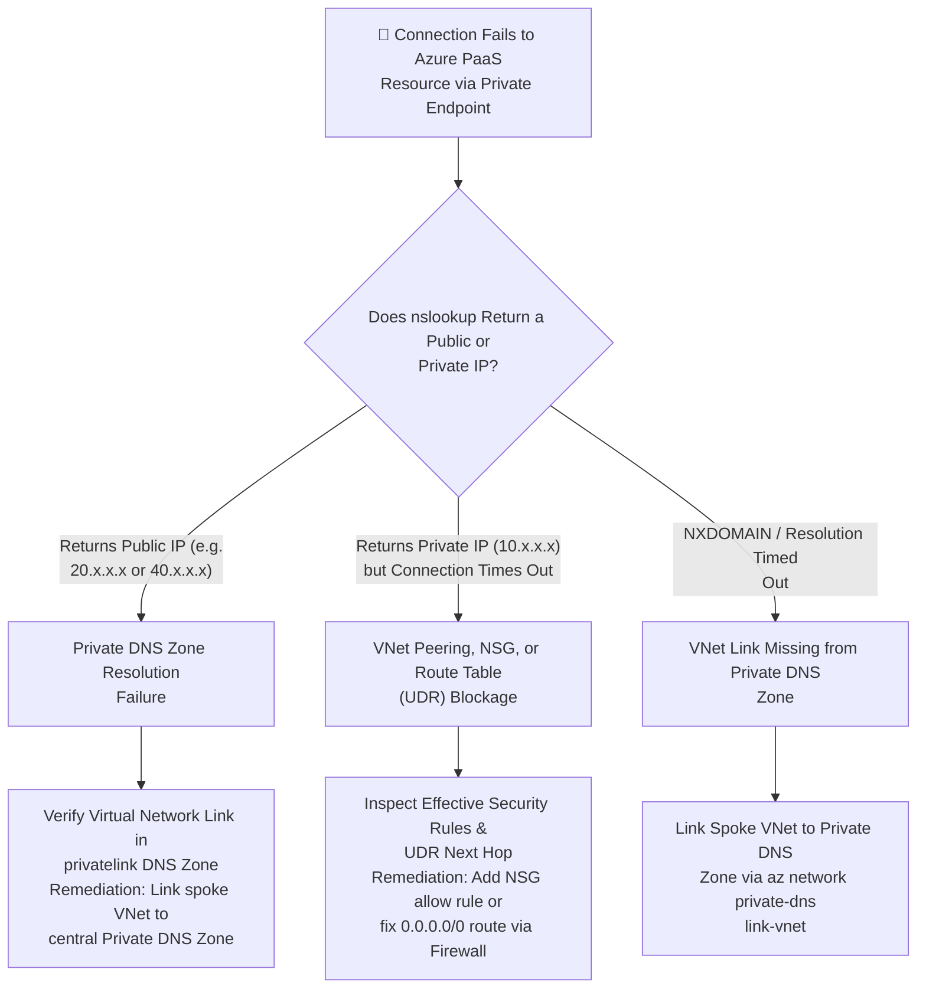

# 🚨 Runbook 02: VNet Peering & Private Endpoint DNS Failures

> **Incident Severity**: `SEV-1 (CRITICAL CONNECTIVITY FAILURE)`  
> **Target Systems**: Azure Private DNS Zones, Private Endpoints, VNet Peering, Azure Firewall, Network Security Groups (NSGs)  
> **Key Error Signatures**: `NameResolutionFailure`, Connection timed out to `privatelink.database.windows.net`, App Service cannot reach backend storage/database.

---

## 1. Emergency Decision Tree



---

## 2. Immediate Diagnostic Procedures (First 5 Minutes)

### Step 1: Perform In-VNet Name Resolution Test
From a VM or container inside the affected VNet:
```bash
# Check DNS resolution
nslookup sql-finance-prod.database.windows.net
```

**Diagnostic Analysis**:
- **Expected Private Output**:
  ```text
  Non-authoritative answer:
  Name:    sql-finance-prod.privatelink.database.windows.net
  Address: 10.20.4.15   <-- Private Endpoint IP inside VNet!
  ```
- **Error Failure Output**:
  ```text
  Name:    sql-finance-prod.database.windows.net
  Address: 20.42.18.99  <-- Public VIP! Connection rejected by firewall!
  ```

### Step 2: Check Effective Routes and NSG Rules via CLI
```bash
# Check effective routes on target network interface
az network nic show-effective-route-table \
  --resource-group rg-networking-prod \
  --name nic-app-vm-01 \
  -o table
```

---

## 3. Root Cause Analysis & Detailed Remediation

### Cause A: Spoke VNet Not Linked to Central Private DNS Zone
- **Root Cause**: In enterprise Hub-and-Spoke architectures, Private DNS Zones reside in the Hub subscription (`rg-dns-hub`). A newly provisioned spoke VNet lacks the Virtual Network Link.
- **Remediation & Recovery Strategy**:
  1. Link the spoke VNet to the central `privatelink.database.windows.net` zone:
     ```bash
     az network private-dns link vnet create \
       --resource-group rg-dns-hub \
       --zone-name privatelink.database.windows.net \
       --name link-spoke-analytics \
       --virtual-network /subscriptions/{subId}/resourceGroups/rg-spoke-analytics/providers/Microsoft.Network/virtualNetworks/vnet-spoke-analytics \
       --registration-enabled false
     ```

---

### Cause B: Missing Return Route in VNet Peering
- **Root Cause**: VNet peering is non-transitive. Spoke A peered to Hub cannot reach Spoke B through the Hub unless User Defined Routes (UDRs) and Azure Firewall / NVA IP forwarding are explicitly configured.
- **Remediation**:
  1. Verify Peering State is `Connected` in both directions:
     ```bash
     az network vnet peering show \
       --resource-group rg-hub \
       --vnet-name vnet-hub \
       --name peer-hub-to-spoke \
       --query "peeringState"
     ```
  2. Add UDR next-hop pointing to Azure Firewall private IP.

---

## 4. Verification & Prevention Checklist

- [ ] `nslookup` resolves to expected `10.x.x.x` private IP address from all workload subnets.
- [ ] Centralized Azure Policy enforces automatic Private DNS Zone linking for all new VNets (`Azure Policy: Deploy-PrivateDNS-Zones`).
- [ ] Network Security Groups permit TCP 1433 (SQL), 443 (HTTPS), or 9092 (Event Hubs) between application subnet and Private Endpoint subnet.
