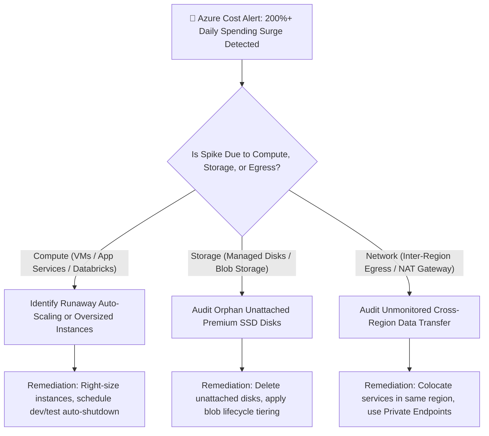

# 🚨 Runbook 03: Azure FinOps Uncontrolled Cost Spikes & Orphan Resources

> **Incident Severity**: `SEV-2 (HIGH / FINANCIAL LOSS)`  
> **Target Systems**: Microsoft Cost Management, Azure Advisor, Orphan Disks, Idle Public IPs, Over-Provisioned App Service Plans  
> **Objective**: Detect unexpected cloud spend surges, eliminate zombie orphan infrastructure, and enforce automated spending anomaly guardrails.

---

## 1. Emergency Decision Tree



---

## 2. Immediate Diagnostic Procedures (First 5 Minutes)

### Step 1: Identify Cost Spike Drivers via Azure CLI
Execute this query to pinpoint the exact service and resource group generating the unexpected burn:
```bash
# Query daily spend breakdown by Resource Group for past 7 days
az consumption usage list \
  --start-date $(date -v -7d "+%Y-%m-%d") \
  --end-date $(date "+%Y-%m-%d") \
  --query "[].{Date:usageStart, ResourceGroup:instanceName, PretaxCost:pretaxCost, Currency:currency}" \
  -o table
```

### Step 2: Hunt for Orphan Unattached Disks
Unattached Premium SSD Managed Disks continue to bill full provisioned capacity 24/7 even after the attached VM is permanently deleted:
```bash
# List all unattached managed disks across subscription
az disk list \
  --query "[?managedBy==null].{Name:name, ResourceGroup:resourceGroup, DiskSizeGB:diskSizeGb, Sku:sku.name}" \
  -o table
```

---

## 3. Root Cause Analysis & Detailed Remediation

### Cause A: Zombie Unattached Managed Disks & Idle Public IPs
- **Root Cause**: Developers terminate Virtual Machines, but forget to check "Delete attached OS and data disks". An idle 1TB P30 Premium SSD generates \$135/month in silent waste.
- **Remediation & Recovery Strategy**:
  1. Delete unattached orphaned disks (or snapshot first if archival is needed):
     ```bash
     # Snapshot disk before deletion
     az snapshot create --resource-group rg-prod --source {diskId} --name snap-archived-disk
     # Delete unattached managed disk
     az disk delete --resource-group rg-prod --name {orphanDiskName} --yes
     ```
  2. Release unassociated Public IP addresses:
     ```bash
     az network public-ip list \
       --query "[?ipConfiguration==null].{Name:name, ResourceGroup:resourceGroup}" \
       -o table
     ```

---

### Cause B: Runaway Cross-Region Egress Bandwidth
- **Root Cause**: An analytical pipeline in East US was reading multi-terabyte datasets from a storage account located in West Europe. Inter-region egress is billed at \$0.087 per GB.
- **Remediation**:
  1. Migrate compute to the same region as the storage account, or use Azure Data Factory incremental delta reads instead of full table scans.

---

## 4. Verification & Prevention Checklist

- [ ] Azure Cost Management Budget configured with automated alert thresholds at 80%, 100%, and 120% of monthly forecast.
- [ ] Azure Advisor Cost Recommendations reviewed and prioritized monthly.
- [ ] Dev/Test Virtual Machines configured with mandatory Auto-Shutdown policies (e.g. 7:00 PM daily shutdown).
- [ ] Tagging policy enforced via Azure Policy (`CostCenter`, `Environment`, `Owner`).
