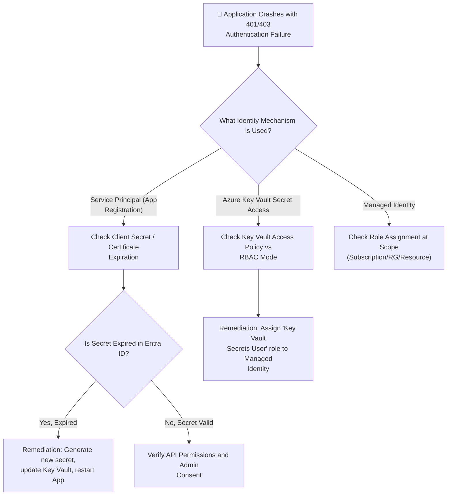

# 🚨 Runbook 04: Entra ID RBAC & Key Vault Secret Rotation Disasters

> **Incident Severity**: `SEV-1 (AUTHENTICATION OUTAGE)`  
> **Target Systems**: Microsoft Entra ID (formerly Azure AD), Azure Key Vault, Service Principals, Managed Identities, Access Policies vs Azure RBAC  
> **Key Error Signatures**: `AADSTS7000222: The provided client secret keys are expired`, `403 Forbidden: Caller is not authorized to perform action on resource`, Application loses database access overnight.

---

## 1. Emergency Decision Tree



---

## 2. Immediate Diagnostic Procedures (First 5 Minutes)

### Step 1: Check Service Principal Secret Expiration
```bash
# Check Service Principal expiration date
az ad app credential list \
  --id {appId} \
  --query "[].{KeyId:keyId, EndDate:endDateTime, Hint:hint}" \
  -o table
```

If `EndDate` is in the past, Entra ID rejects all token acquisition requests with `AADSTS7000222`.

### Step 2: Test Key Vault Secret Retrieval
```bash
# Test Key Vault secret access
az keyvault secret show \
  --vault-name kv-production-prod \
  --name db-connection-string \
  -o json
```

---

## 3. Root Cause Analysis & Detailed Remediation

### Cause A: Expired Service Principal Client Secret
- **Root Cause**: The client secret had a 1-year expiration date and was not monitored by automated alerts.
- **Remediation & Recovery Strategy**:
  1. Generate a new secret immediately:
     ```bash
     NEW_SECRET=$(az ad app credential reset --id {appId} --years 1 --query "password" -o tsv)
     ```
  2. Update the secret in Azure Key Vault:
     ```bash
     az keyvault secret set \
       --vault-name kv-production-prod \
       --name sp-client-secret \
       --value "$NEW_SECRET"
     ```
  3. Restart the consuming App Service or Kubernetes deployment:
     ```bash
     az webapp restart --resource-group rg-prod --name app-ecommerce
     ```

---

### Cause B: Key Vault Permission Model Conflict (Access Policy vs Azure RBAC)
- **Root Cause**: Key Vault was switched from "Vault Access Policy" to "Azure Role-Based Access Control (Azure RBAC)". Existing access policies were disabled, and new RBAC roles were not assigned.
- **Remediation**:
  1. Assign the standard reader role to the application's Managed Identity:
     ```bash
     az role assignment create \
       --assignee {managedIdentityPrincipalId} \
       --role "Key Vault Secrets User" \
       --scope "/subscriptions/{subId}/resourceGroups/{rg}/providers/Microsoft.KeyVault/vaults/kv-production-prod"
     ```

---

## 4. Verification & Prevention Checklist

- [ ] Transition from static Service Principal secrets to **User-Assigned Managed Identities** (zero secrets to rotate!).
- [ ] For remaining Service Principals, configure Azure Event Grid alerts 30 days and 7 days prior to credential expiration.
- [ ] Key Vault soft-delete and purge protection enabled to prevent accidental secret loss.

---

## 5. Mosaic AI Gateway & Azure Key Vault Secret Rotation Triage

### 5.1 Incident Symptoms & Root Cause
- **Symptoms**: Enterprise generative AI applications report `HTTP 401 Unauthorized: Invalid API Key` or `Secret NotFound` when invoking Databricks Mosaic AI Gateway routes backed by Azure OpenAI Service or external LLMs.
- **Root Cause**: An automated Azure Key Vault secret rotation policy rotated the API key without notifying the Databricks Secret Scope or refreshing the cached token in the AI Gateway serving container.

### 5.2 Emergency Remediation & Token Refresh
1. **Verify Secret in Key Vault**:
```bash
# Verify rotated secret version in Azure Key Vault
az keyvault secret show   --vault-name "kv-enterprise-prod"   --name "azure-openai-key"   --query "id" -o tsv
```

2. **Trigger Databricks AI Gateway Endpoint Reload**:
```python
# Force-refresh secret binding on AI Gateway route
from databricks.sdk import WorkspaceClient

w = WorkspaceClient()
# Triggering config update invalidates cached secret tokens
w.serving_endpoints.update_config_and_wait(
    name="azure-openai-enterprise-gateway",
    served_entities=[{
        "name": "azure-gpt-4o",
        "external_model": {
            "name": "gpt-4o",
            "provider": "azure-openai",
            "task": "llm/v1/chat",
            "azure_openai_config": {
                "azure_endpoint": "https://corp-genai-eastus.openai.azure.com",
                "azure_deployment_name": "gpt-4o-prod-deployment",
                "azure_api_key": "{{secrets/azure_keyvault/azure_openai_key}}"
            }
        }
    }]
)
```
