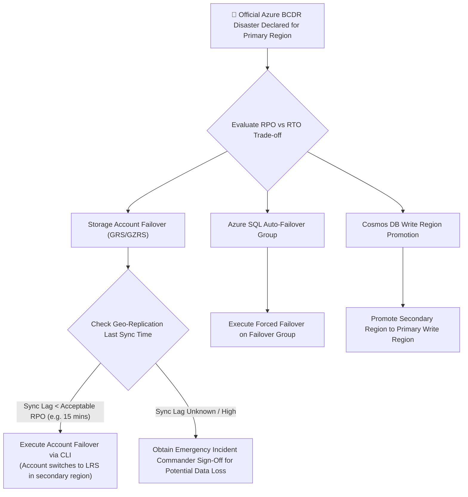

# 🚨 Runbook 05: BCDR & Cross-Region Geo-Replication Failover

> **Incident Severity**: `SEV-1 (DISASTER RECOVERY / CATASTROPHIC REGIONAL FAILURE)`  
> **Target Systems**: Azure Storage (GRS/GZRS), Azure SQL Failover Groups, Cosmos DB Multi-Region, Azure Site Recovery (ASR)  
> **Objective**: Execute structured failover of core databases and persistent storage from primary to secondary paired region during an unrecoverable disaster.

---

## 1. Emergency Decision Tree



---

## 2. Immediate Diagnostic Procedures (First 5 Minutes)

### Step 1: Check Last Sync Time for Geo-Redundant Storage
Before triggering customer-initiated storage failover, inspect the replication lag:
```bash
# Check secondary region replication lag
az storage account show \
  --name stanalyticsdata \
  --resource-group rg-storage-prod \
  --query "geoReplicationStats" \
  -o json
```
Output:
```json
{
  "canFailover": true,
  "lastSyncTime": "2026-11-18T04:15:30Z",
  "status": "live"
}
```
If `lastSyncTime` is 10 minutes ago, you will lose up to 10 minutes of newly written data upon failover.

---

## 3. Root Cause Analysis & Detailed Remediation

### Action A: Customer-Initiated Storage Account Failover
- **Execution Protocol**:
  ```bash
  az storage account failover \
    --name stanalyticsdata \
    --resource-group rg-storage-prod \
    --yes
  ```
- **Post-Failover Note**: The primary endpoint DNS automatically updates to point to the secondary region. The storage redundancy converts to LRS; after regional recovery, you must re-enable GRS manually.

---

### Action B: Azure SQL Failover Group Promotion
- **Execution Protocol**:
  ```bash
  az sql failover-group set-primary \
    --resource-group rg-sql-secondary \
    --server sql-westus-prod \
    --name fg-finance-prod
  ```
- **Architectural Advantage**: Client connection strings (`fg-finance-prod.database.windows.net`) remain unchanged; Azure automatically redirects connection routing to the newly promoted primary server.

---

## 4. Verification & Prevention Checklist

- [ ] Application health endpoints in secondary region return HTTP 200 OK.
- [ ] Database read and write workloads execute normally against the promoted secondary.
- [ ] Document exact failover execution timestamp and estimated data loss window for postmortem audit compliance.
