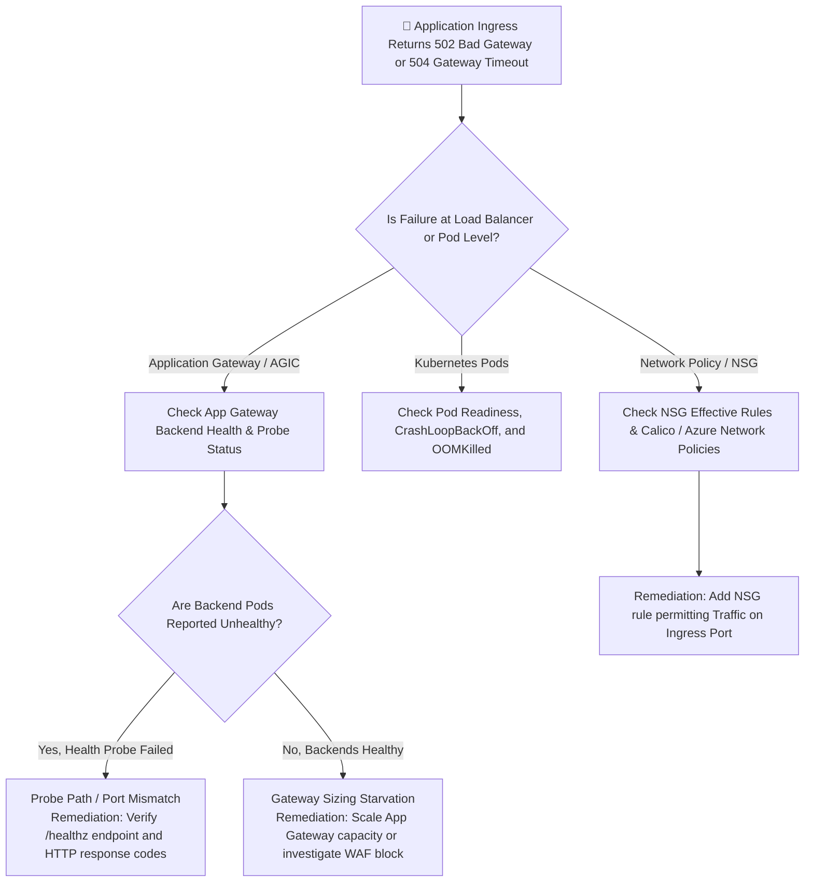

# 🚨 Runbook 06: AKS Ingress & Network Security Group (NSG) Lockouts

> **Incident Severity**: `SEV-2 (HIGH / APPLICATION ACCESS DEGRADED)`  
> **Target Systems**: Azure Kubernetes Service (AKS), Application Gateway Ingress Controller (AGIC), Network Security Groups (NSGs), Azure CNI  
> **Key Error Signatures**: `502 Bad Gateway`, `Connection refused` on ingress, AKS pods unable to reach external egress APIs, Node not ready.

---

## 1. Emergency Decision Tree



---

## 2. Immediate Diagnostic Procedures (First 5 Minutes)

### Step 1: Inspect Application Gateway Backend Health
```bash
# Check real-time backend pool health via CLI
az network application-gateway show-backend-health \
  --resource-group rg-aks-networking \
  --name agw-ingress-prod \
  --query "backendAddressPools[].backendHttpSettingsCollection[].servers[].{Address:address, Health:health}" \
  -o table
```

If health is `Unhealthy`, the Application Gateway is actively dropping traffic and returning `502 Bad Gateway`.

### Step 2: Check Pod Status in Target Namespace
```bash
kubectl get pods -n production -o wide
kubectl describe pod {failed-pod-name} -n production
```

---

## 3. Root Cause Analysis & Detailed Remediation

### Cause A: Custom NSG Blocking Application Gateway Ingress
- **Root Cause**: An NSG applied to the AKS node subnet lacks the mandatory allow rule for Application Gateway subnet traffic.
- **Remediation & Recovery Strategy**:
  1. Add an allow rule on the AKS subnet NSG:
     ```bash
     az network nsg rule create \
       --resource-group rg-aks-networking \
       --nsg-name nsg-aks-nodes \
       --name Allow-AppGateway-Inbound \
       --priority 200 \
       --source-address-prefixes "10.10.1.0/24" \
       --destination-port-ranges 80 443 8080 \
       --access Allow \
       --protocol Tcp
     ```

---

### Cause B: Health Probe Path Mismatch
- **Root Cause**: The custom probe was configured for `/` while the container requires authentication on `/` and only serves unauthenticated HTTP 200 on `/healthz`.
- **Remediation**:
  1. Update ingress manifest annotations:
     ```yaml
     apiVersion: networking.k8s.io/v1
     kind: Ingress
     metadata:
       name: app-ingress
       annotations:
         appgw.ingress.kubernetes.io/health-probe-path: "/healthz"
     ```

---

## 4. Verification & Prevention Checklist

- [ ] `az network application-gateway show-backend-health` reports all targets `Healthy`.
- [ ] Application Gateway WAF in `Detection` mode during initial rollout to prevent accidental false-positive rule blocking.
- [ ] Pod Disruption Budgets (PDB) and readiness probes configured for all microservices.
